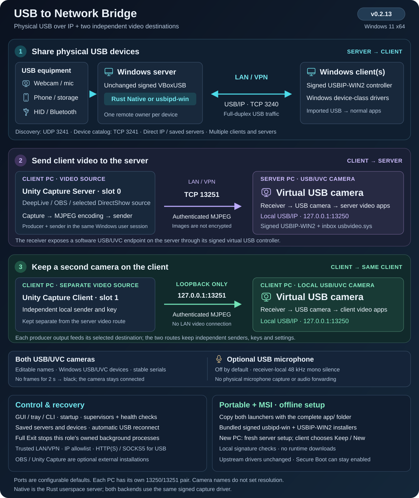
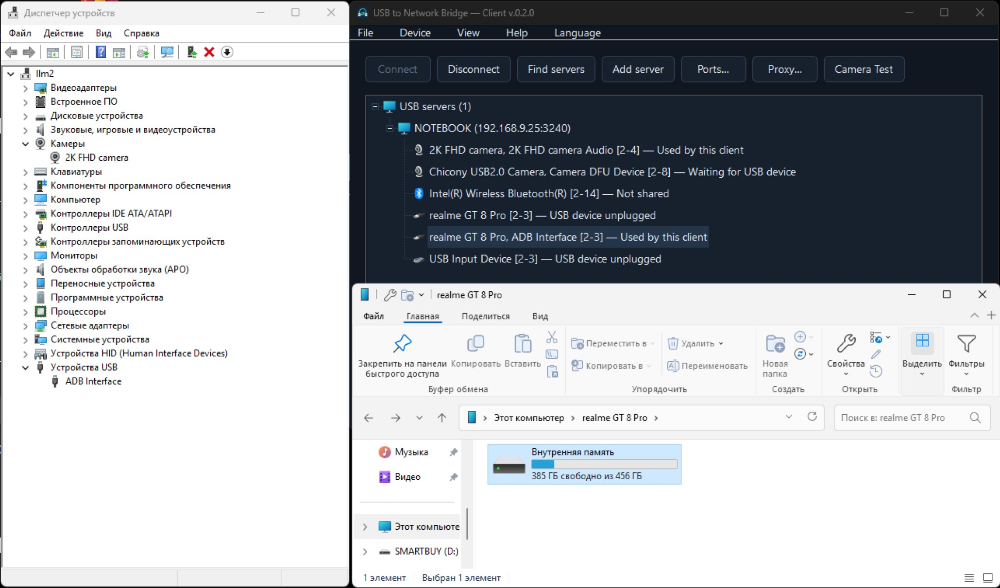
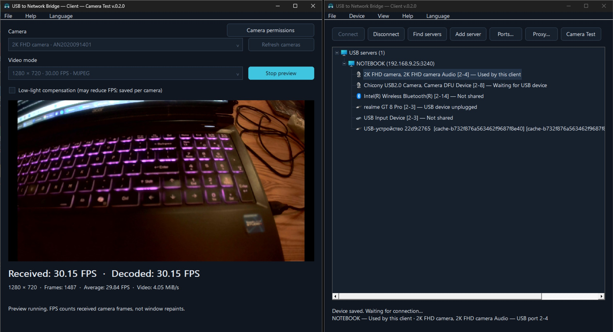

# USB to Network Bridge

[](https://github.com/AlexeySmirnov74/USB-to-Network-Bridge/releases/latest)
[](https://github.com/AlexeySmirnov74/USB-to-Network-Bridge/actions/workflows/ci.yml)
[](https://github.com/AlexeySmirnov74/USB-to-Network-Bridge#quick-start)
[](https://github.com/AlexeySmirnov74/USB-to-Network-Bridge/blob/main/Cargo.toml)
[](https://github.com/AlexeySmirnov74/USB-to-Network-Bridge/blob/main/LICENSE)
[](https://github.com/AlexeySmirnov74/USB-to-Network-Bridge/stargazers)

[English](README.md) · [Français](README.fr.md) · [Русский](README.ru.md) · [Deutsch](README.de.md) · [简体中文](README.zh-CN.md)

Ein quelloffener USB-over-IP-Redirector (USB/IP) für Windows 11 x64. Teilen Sie echte USB-Geräte über LAN oder VPN zwischen Windows-PCs, darunter Webcams und ADB/Speicher von Android-Telefonen. Der Rust-Server gibt ausgewählte Geräte frei; der Windows-Client bindet sie über einen virtuellen USB-Controller ein. Keine Aktivierung, keine Testzeitbegrenzung und kein lizenzbedingtes Gerätelimit.

**v0.2.12 — Windows 11 x64.** USB-Server und Client in Rust mit grafischer Oberfläche, Kommandozeile, automatischer Suche und Wiederverbindung sowie MSI-Installer und portablem ZIP. [Aktuelle Version herunterladen](https://github.com/AlexeySmirnov74/USB-to-Network-Bridge/releases/latest).

**Offline-Einrichtung:** Portables ZIP und MSI enthalten die signierten Server- und Client-Treiberinstaller. Kopieren Sie beide EXE-Dateien und den gesamten Ordner `app` auf einen anderen Windows-11-x64-PC; die Ersteinrichtung verwendet ausschließlich lokale Dateien. [Installation](docs/installation.md) · [Treiberlizenzen und Quellcode](docs/driver-sources.md).

**Agentenprüfung in v0.2.1:** Server- und Client-Controller haben eigene Supervisoren. Beendete Controller starten automatisch neu; ein eingefrorener Heartbeat wird nach zwei Minuten erkannt. Unabhängige Aufgaben prüfen die Supervisoren jede Minute. Veraltete Berichte melden Geräte nicht mehr als verbunden. Diagnose: `usbbridge --config FILE server health` oder `client health`. [Änderungen](CHANGELOG.md).




**v0.2.3:** Kameranamen werden zwischen DirectShow und Media Foundation synchronisiert. Die Aufnahme wacht bei einem neuen Bild auf, verwendet begrenzte Arbeitspuffer erneut und meldet Verarbeitungszeiten. Für eine Videoanwendung auf dem Client-PC gibt es eine [OBS-/Unity-Capture-Anleitung](docs/third-party-video.md) auf Englisch mit CLI-Beispielen und Aufgabenbeschreibung für ein weiteres Projekt.

## USB-Kamera aus einer entfernten Videoquelle

**Neu in v0.2.2:** Video vom Windows-Client an eine USB/UVC-Kamera auf dem Windows-Server senden. Unter **Server → USB-Kamera — Video empfangen** den Namen festlegen, etwa `4k web camera`. Auf dem Client unter **Gerät → Video senden** Quelle, Serveradresse und denselben Verbindungsschlüssel wählen. Die Kamera nutzt den signierten USBIP-WIN2-Controller und Windows `usbvideo.sys`, ohne den vorgeschriebenen Media-Foundation-Namenszusatz. Installierte OBS-/Unity-Capture-Quellen werden über DirectShow ausgewählt. [Video-Schnellstart](docs/virtual-camera.md).

Der authentifizierte TCP/MJPEG-Pfad hält die USB-Kamera bei Verbindungsproblemen angemeldet und zeigt Schwarz, bis die Quelle zurückkehrt. Beide Endpunkte haben Autostart und unabhängige Heartbeat-Prüfungen. Der Name bestimmt nicht die Auflösung; mit einer echten Kamera wurden ungefähr 30 FPS bei 1280×720 gemessen. Ein vertrauenswürdiges LAN oder VPN verwenden: die Authentifizierung verschlüsselt die Bilder nicht. Der virtuelle USB-Controller bleibt im Windows-Gerätebaum erkennbar.

**Optionales stummes Mikrofon:** aktivieren Sie **Silent microphone** in den Einstellungen der empfangenden Kamera. Der USB-Audioeingang gehört zum selben Verbundgerät und liefert ausschließlich Stille, ohne ein echtes Mikrofon aufzunehmen. Wählen Sie ihn bei Bedarf separat in den Audioeinstellungen der Messenger-App. [Einrichtung](docs/dual-camera.md#optional-silent-microphone).

## Zwei unabhängige Videoziele

**Unity Capture Server** sendet den Videostream an die USB-Kamera des Servers (z. B. `4k web camera`); **Unity Capture Client** an eine separate USB-Kamera auf dem Client (standardmäßig `2k web camera`). Beide Kameras haben eigene dauerhafte Identitäten und änderbare Namen. Die Client-Kamera wird unter **Device → Client USB camera** konfiguriert. Die lokale Route verwendet Loopback; Serveradresse und Verbindungsschlüssel bleiben erhalten. [Einrichtung](docs/dual-camera.md).

## Funktionen

- Automatische Serversuche oder direkte IP/Hostname mit Port; mehrere gespeicherte Server und Wiederverbindung nach Neustart oder erneutem Einstecken.
- Einzelne Geräte freigeben, ohne andere USB-Sitzungen neu zu starten. Pro Gerät ist jeweils ein entfernter Client möglich.
- Umschalten zwischen Rust-Transport `Native` und `usbipd-win`. Beide verwenden den unveränderten signierten VBoxUSB-Treiber; der Client nutzt den signierten virtuellen USBIP-WIN2-Controller.
- Dunkle Oberfläche, Infobereich und [Kommandozeile](docs/command-line.md). Standardsprache Englisch; Deutsch, Französisch, Russisch und vereinfachtes Chinesisch verfügbar.
- HTTP CONNECT, HTTPS CONNECT oder SOCKS5 pro Server; Zugangsdaten lokal durch Windows DPAPI geschützt.
- **Camera Test** mit empfangenen/dekodierten FPS. Der Client speichert den Schwachlichtausgleich pro Kamera; Aktivierung kann die FPS senken. Das Testfenster sperrt bei beiden Rollen das Hauptfenster bis zum Schließen.
- Windows-Autostart, Ports, IP-Freigaben, lokale Nutzung ohne Client und Bereinigung entfernter Geräte nach standardmäßig einem Tag.

**Enabled** in der Servertabelle erlaubt lokale Nutzung ohne verbundenen Client, unabhängig von **Share**. Für eine dauerhaft reservierte Webcam deaktiviert lassen. Gleichzeitige lokale und entfernte Nutzung desselben erfassten Geräts ist nicht möglich.

## usbipd-win und Native Rust

Dies sind zwei **Servermodule**, keine unterschiedlichen Kerneltreiber. [usbipd-win](https://github.com/dorssel/usbipd-win) stellt den ursprünglichen USB/IP-Dienst und die Geräteverwaltung bereit; **Native** ist unsere eigene USB-Erfassung und unser USB/IP-Server in Rust.

| Komponente | Standard-usbipd-win | Native Rust |
| --- | --- | --- |
| Server für USB-Daten | usbipd-win-Dienst in C#/.NET | Unsere Rust-Anwendung usbbridge-server.exe |
| Physische USB-Erfassung | Offiziell signierter VBoxUSB-Treiber | Derselbe unveränderte, signierte VBoxUSB-Treiber |
| Datenpfad auf dem Server | USB → VBoxUSB → usbipd-win-Dienst → TCP | USB → VBoxUSB → Rust-Server → TCP |
| Übertragungen | Implementierung des usbipd-win-Projekts | Direkte asynchrone IOCTL/IOCP-Erfassung, parallele ausstehende Anfragen, begrenzte Puffer/Warteschlangen und TCP_NODELAY |
| Windows-Client | Unser Client steuert den signierten virtuellen USBIP-WIN2-Controller | Derselbe Client und USBIP-WIN2-Controller |
| Abhängigkeit von usbipd-win | Standardserver und Geräteverwaltung | Weiterhin für Installation, Inventar und Reservierung nötig; der Dienst leitet keine Native-USB-Daten weiter |

Mit Native können wir den USB-/Netzwerkpfad direkt abstimmen. Beispielsweise stellte die Initialisierung der Gerätegeschwindigkeit im Treiber vor der Übernahme bei der getesteten Chicony im Modus 1280 × 720 MJPEG etwa **30 FPS** wieder her. Das ist ein gerätespezifisches Messergebnis, keine allgemeine Geschwindigkeitsgarantie. Siehe [Messungen](docs/performance.md) und [Architektur](docs/architecture.md).

Serversuche, GUI/Tray, gespeicherte Auswahl, Wiederverbindung und Proxy-Unterstützung gehören zu USB to Network Bridge und stehen bei beiden Modulen bereit. Das Modul lässt sich in den Servereinstellungen wechseln; aktive Geräte verbinden sich dabei neu. Test Signing oder der Austausch des signierten Kerneltreibers sind nicht erforderlich.

## Screenshots

### Android-Telefon auf dem Windows-Client



Der Client hat ein realme GT 8 Pro eingebunden. Auf dem entfernten Windows-PC sind dessen ADB-Schnittstelle und interner Speicher verfügbar.

### Webcam-Vorschau und FPS auf dem Windows-Client



1280 × 720 MJPEG im 30-FPS-Modus. Camera Test zeigt **30,15 empfangene und dekodierte FPS**, im **Durchschnitt 29,84 FPS**. Der Schwachlichtausgleich ist ausgeschaltet.

Eine kurze Übersicht und Einsatzbeispiele bietet die [englische Projekt-FAQ](docs/project-overview.md).

## Schnellstart

Benötigt werden zwei Windows-11-x64-PCs, Administratorrechte für Treiber/Einrichtung und ein vertrauenswürdiges LAN/VPN. Secure Boot kann eingeschaltet bleiben; offizielle Treiber erfordern keinen Testsignaturmodus. Die Übernahme einer Maus, Tastatur oder Festplatte macht sie lokal vorübergehend unbenutzbar.

Laden Sie das MSI oder das vollständige portable ZIP aus [Releases](https://github.com/AlexeySmirnov74/USB-to-Network-Bridge/releases/latest) herunter. Entpacken Sie das gesamte Archiv beispielsweise nach `C:\USBBridge`. Im Stammordner liegen nur zwei Starter und der Komponentenordner:

```text
USB-to-Network-Bridge-Server.exe
USB-to-Network-Bridge-Client.exe
app/
```

Starten Sie **`USB-to-Network-Bridge-Server.exe`** auf dem Server oder **`USB-to-Network-Bridge-Client.exe`** auf dem Client. Die MSI-Verknüpfungen im Startmenü verwenden dieselben Starter. Der Ordner `app` muss daneben bleiben; er enthält interne EXE-Dateien, PowerShell-Helfer, Dokumentation und Lizenzen. Das Kommandozeilenprogramm ist `app\usbbridge.exe`. Einzeln geladene Starter benötigen das vollständige Paket derselben Version.

Beim Start werden die Treiber der gewählten Rolle geprüft. Fehlende Treiber werden aus den geprüften lokalen Installationsdateien unter `app\tools\driver-installers` installiert; Einrichtung und Reparatur laden nichts herunter. Kopieren Sie den vollständigen Ordner einschließlich `app` auf den neuen PC. Bestätigen Sie UAC bei Bedarf und starten Sie Windows nur manuell neu, falls angefordert. Secure Boot, Treibersignaturen, vorhandene Treiber und Rolleneinstellungen bleiben erhalten.

Ein neuer **Server** ist zunächst deaktiviert, erlaubt nur Loopback und gibt keine Geräte frei. Tragen Sie in **Settings** die tatsächlichen LAN/VPN-IP-Adressen der Clients ein, aktivieren Sie den Server und wählen Sie per Rechtsklick **Share** oder doppelklicken Sie eine nicht freigegebene Zeile. Native/usbipd-win wird in den Einstellungen gewählt; ein Modulwechsel verbindet aktive Geräte neu.

Wird ein eingerichteter portabler **Client** auf einen anderen PC kopiert, können Sie gespeicherte Serververbindungen behalten oder mit neuen Einstellungen beginnen. Abbrechen ändert nichts. Behalten übernimmt Server, Geräteauswahl und Einstellungen; an das bisherige Windows gebundene Zugangsdaten und die lokale Kamera müssen neu eingerichtet werden. Ein Server auf einem anderen PC erhält eine neue maschinenspezifische Einrichtung. [Details zum Umzug](docs/installation.md#moving-a-portable-copy-to-another-pc).

Pfade in Einstellungen beziehen sich auf die jeweilige JSON-Datei; `@app` bezeichnet den aktuellen Anwendungsordner. Schließen Sie für einen Umzug innerhalb derselben Windows-Installation die Anwendungen, verschieben Sie beide EXE-Dateien samt vollständigem `app`-Ordner und öffnen Sie den gewünschten Starter. Eine einmalige UAC-Abfrage aktualisiert zugehörige Autostartaufgaben, Firewallregeln und Verknüpfungen; Einstellungen, Kameraidentitäten und Schlüssel bleiben erhalten. Die vollständigen Pfade der Windows-Registrierungen werden automatisch aktualisiert.

Über **Datei → Anwendung beenden** oder **Taskleistensymbol → Anwendung beenden** stoppen Sie die gewählte Rolle vollständig, einschließlich USB-Verbindungen und Videoprozessen. Die Überwachung respektiert dies bis zum erneuten Öffnen oder Windows-Neustart; die Autostarteinstellung bleibt erhalten. Das Schließen des Fensters lässt die Hintergrundprozesse weiterlaufen.

**Find servers** wählen, Server und freigegebenes Gerät markieren, dann **Connect**. Bei Bedarf über **Add server** die LAN/VPN-Adresse eintragen. Die Auswahl wird gespeichert; **Disconnect** beendet die entsprechende automatische Wiederverbindung. Über den Serverknoten lassen sich alle seine Geräte pausieren, ohne andere Server zu beeinflussen.

Webcamtest: Rechtsklick → **Camera Test**. Der lokale Servertest benötigt eine lokal verfügbare Kamera; eine entfernt übernommene Kamera wird auf dem Client getestet. Ohne stabile eindeutige USB-Identität kann nach einem Portwechsel eine erneute Auswahl nötig sein.

| Kanal | Standardport | Zweck |
| --- | --- | --- |
| TCP | 3240 | USB/IP-Daten |
| UDP | 3241 | Lokale IPv4-Serversuche |
| TCP | 3241 | Gerätekatalog und Status |

Ports **1–65535**; USB- und Katalogport müssen unterschiedlich sein. Suchport auf Clients passend einstellen. Ein Proxy muss beide TCP-Ports zulassen; UDP-Suche wird nicht durch den Proxy geleitet.

## Betrieb und Build

Das Schließen der Oberfläche beendet keine Hintergrundarbeit. Startaufgaben stellen Verbindungen bereits vor der Benutzeranmeldung wieder her; danach erscheint das Symbol. Eine Instanz je Rolle und PC. Autostart deaktivieren: denselben `Set-Autostart.ps1`-Befehl mit gleichen Pfaden und `-Disable` ausführen.

Rotierende Logs: `logs\*.debug.jsonl` neben der Konfiguration. Keine Bilder, USB-Nutzdaten oder Passwörter; IPs, Pfade und Seriennummern können enthalten sein. Vor Veröffentlichung prüfen. USB/IP ist hier weder verschlüsselt noch authentifiziert: LAN/VPN und IP-Filter verwenden, Ports nicht direkt ins Internet öffnen. HTTPS-Proxy verschlüsselt nur den Weg Client–Proxy. Längere Ausfälle können eine USB-Neuerkennung erzwingen; unterbrechungsfreie Sitzungen sind nicht garantiert.

Buildvoraussetzungen: Rust stable MSVC mit `rustfmt`/`clippy`, MSVC C++ Build Tools und Windows SDK:

```powershell
git clone https://github.com/AlexeySmirnov74/USB-to-Network-Bridge.git
Set-Location USB-to-Network-Bridge
.\Build.ps1
.\Download-Drivers.ps1 -Role Both
.\Package.ps1
```

Das ZIP unter `dist` enthält beide unveränderten signierten Treiberinstaller, EXE-Dateien, Laufzeitskripte, Beispiele und Lizenzen. Entwickler führen vor dem Packen einmal `Download-Drivers.ps1 -Role Both` mit Internetzugang aus. SHA-256 und Authenticode werden anhand von `driver-installers.json` offline geprüft. CI lädt Abhängigkeiten beim Build, installiert keine Treiber und ersetzt keine Hardwaretests. Optional installiert `Bootstrap.ps1` Rust; `-InstallBuildTools` ergänzt Microsoft-Werkzeuge.

**Windows PowerShell 5.1 und die Laufzeit-`.ps1` sind erforderlich** für Freigabe, Erfassung, Modulwechsel und Autostart. Buildskripte werden auf einem eingerichteten PC nicht benötigt. Projekteigene EXE-Dateien und das MSI sind nicht Authenticode-signiert; USB-Treiber behalten ihre offiziellen Signaturen. Das MSI unterstützt Installation, Reparatur, Upgrade, Rollback und Deinstallation. [Installation](docs/installation.md) · [Build und Veröffentlichung](docs/production-readiness.md).

[Architektur](docs/architecture.md) · [CLI](docs/command-line.md) · [Kameras](docs/camera-preview.md) · [Leistung](docs/performance.md) · [Hardwaretests](docs/hardware-tests.md) · [Kennungen](docs/device-identifiers.md) · [Speicherprüfung](docs/memory-audit.md). Einige technische Notizen sind auf Russisch.

Projektcode unter [MIT](LICENSE); Abhängigkeiten und Treiber behalten ihre [Lizenzen](THIRD-PARTY.txt). Lokale Einstellungen, Logs, USB-Inventare, Zugangsdaten und Signaturschlüssel sind nicht in öffentlichen Paketen enthalten.
