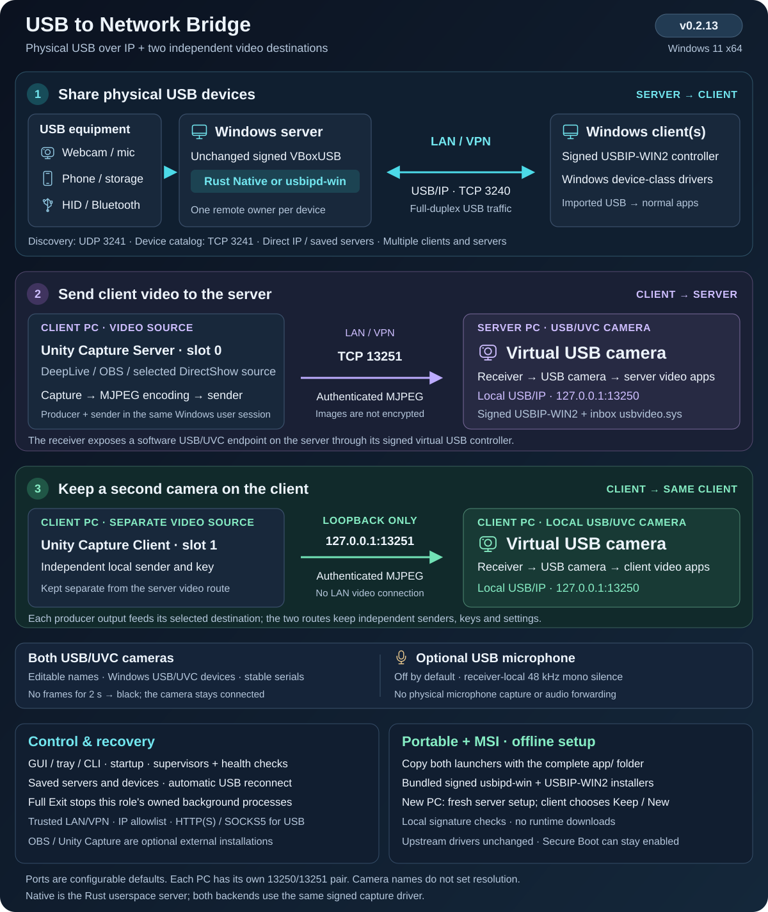
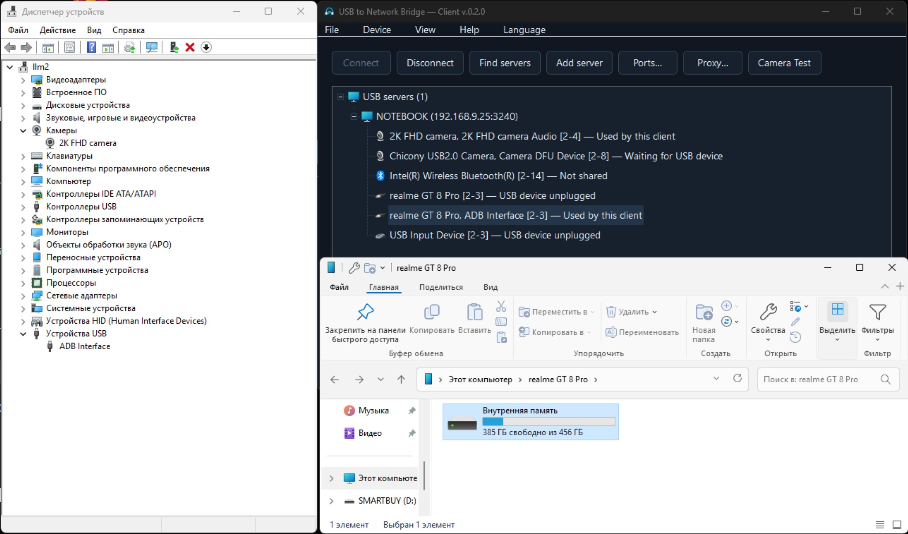
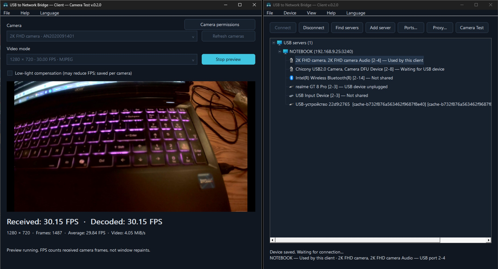

# USB to Network Bridge

[](https://github.com/AlexeySmirnov74/USB-to-Network-Bridge/releases/latest)
[](https://github.com/AlexeySmirnov74/USB-to-Network-Bridge/actions/workflows/ci.yml)
[](https://github.com/AlexeySmirnov74/USB-to-Network-Bridge#quick-start)
[](https://github.com/AlexeySmirnov74/USB-to-Network-Bridge/blob/main/Cargo.toml)
[](https://github.com/AlexeySmirnov74/USB-to-Network-Bridge/blob/main/LICENSE)
[](https://github.com/AlexeySmirnov74/USB-to-Network-Bridge/stargazers)

[English](README.md) · [Français](README.fr.md) · [Русский](README.ru.md) · [Deutsch](README.de.md) · [简体中文](README.zh-CN.md)

Un redirecteur USB over IP (USB/IP) open source pour Windows 11 x64. Partagez de vrais périphériques USB sur un LAN ou un VPN, dont webcams et interfaces ADB/stockage de téléphones Android. Le serveur Rust exporte les appareils sélectionnés ; le client Windows les importe via un contrôleur USB virtuel. Sans activation, expiration d'essai ni quota de périphériques lié à une licence.

**v0.2.12 — Windows 11 x64.** Serveur et client USB en Rust avec interface graphique, ligne de commande, découverte et reconnexion automatiques, installateur MSI et ZIP portable. [Télécharger la dernière version](https://github.com/AlexeySmirnov74/USB-to-Network-Bridge/releases/latest).

**Installation hors ligne :** le ZIP portable et le MSI incluent les installateurs signés des pilotes serveur et client. Copiez les deux EXE et tout le dossier `app` vers un autre PC Windows 11 x64 ; la première installation utilise uniquement les fichiers locaux. [Installation](docs/installation.md) · [Licences et sources des pilotes](docs/driver-sources.md).

**État des agents dans la v0.2.1 :** les contrôleurs serveur et client ont des superviseurs distincts. Un contrôleur arrêté redémarre automatiquement ; un signal de vie figé est détecté après deux minutes. Des tâches indépendantes vérifient aussi les superviseurs chaque minute. Les anciens rapports ne déclarent plus un périphérique connecté. Diagnostic : `usbbridge --config FILE server health` ou `client health`. [Modifications](CHANGELOG.md).




**v0.2.3 :** le nom est synchronisé entre DirectShow et Media Foundation. La capture se réveille à l’arrivée d’une image, réutilise des tampons bornés et publie ses temps de traitement. Pour une application source sur le PC client, suivre le [guide OBS/Unity Capture](docs/third-party-video.md) en anglais, avec exemples CLI et consignes pour un autre projet.

## Caméra USB alimentée par une source vidéo distante

**Nouveau dans v0.2.2 :** envoyer la vidéo du client Windows vers une caméra USB/UVC sur le serveur Windows. Dans **Serveur → Caméra USB — réception vidéo**, choisir son nom, par exemple `4k web camera`. Sur le client, ouvrir **Périphérique → Envoyer la vidéo**, puis sélectionner la source, l’adresse du serveur et la même clé de connexion. La caméra utilise le contrôleur signé USBIP-WIN2 et `usbvideo.sys` de Windows, sans suffixe Media Foundation obligatoire. Les sources OBS/Unity Capture installées sont sélectionnées via DirectShow. [Démarrage rapide vidéo](docs/virtual-camera.md).

Le transport TCP/MJPEG authentifié conserve la caméra USB lors d’une perte de source et affiche du noir jusqu’à la reconnexion automatique. Les deux modules ont un démarrage automatique et un contrôle indépendant du heartbeat. Le nom ne fixe pas la résolution : environ 30 FPS à 1280×720 ont été mesurés avec une vraie caméra. Utiliser un LAN de confiance ou un VPN : l’authentification ne chiffre pas les images. Le contrôleur USB virtuel reste identifiable dans l’arbre des périphériques Windows.

**Microphone silencieux facultatif :** activez **Silent microphone** dans les paramètres de la caméra réceptrice pour ajouter une entrée USB Audio Class au même périphérique composite. Elle fournit uniquement du silence et ne capture aucun microphone réel. Sélectionnez-la séparément dans les paramètres audio de la messagerie si nécessaire. [Configuration](docs/dual-camera.md#optional-silent-microphone).

## Deux destinations vidéo indépendantes

**Unity Capture Server** envoie la vidéo vers la caméra USB du serveur (par exemple `4k web camera`), et **Unity Capture Client** vers une caméra USB distincte sur le client (`2k web camera` par défaut). Les deux caméras ont des identités persistantes distinctes et des noms modifiables. Configurez la caméra cliente dans **Device → Client USB camera**. Le trajet local utilise uniquement la boucle locale ; la destination et la clé du serveur sont conservées. [Configuration](docs/dual-camera.md).

## Fonctionnalités

- Découverte automatique ou adresse IP/nom et port ; plusieurs serveurs enregistrés et reconnexion après redémarrage ou rebranchement.
- Partage individuel sans redémarrer les autres sessions USB ; un seul client distant par périphérique à la fois.
- Serveur Rust `Native` ou service `usbipd-win`, tous deux avec le pilote VBoxUSB signé fourni en amont. Le client utilise le contrôleur virtuel USBIP-WIN2 signé.
- Interface sombre, zone de notification et [ligne de commande](docs/command-line.md). Anglais par défaut ; français, russe, allemand et chinois simplifié disponibles.
- HTTP CONNECT, HTTPS CONNECT et SOCKS5 par serveur ; identifiants protégés localement par Windows DPAPI.
- **Camera Test** avec FPS reçus/décodés ; compensation de faible éclairage mémorisée par caméra sur le client. Cette option peut réduire les FPS. La fenêtre de test bloque la fenêtre principale des deux rôles jusqu’à sa fermeture.
- Démarrage Windows, ports et IP autorisées configurables, usage local sans client et nettoyage des appareils débranchés après un jour par défaut.

La case **Enabled** du serveur autorise l’usage local en l’absence de client, indépendamment de **Share**. Laissez-la décochée pour réserver une webcam au distant. Un appareil capturé ne peut pas être utilisé simultanément localement et à distance.

## usbipd-win et Native Rust

Il s'agit de deux **modules serveur**, et non de deux pilotes noyau différents. [usbipd-win](https://github.com/dorssel/usbipd-win) fournit le service USB/IP amont et la gestion des appareils ; **Native** est notre propre module de capture et serveur USB/IP en Rust.

| Composant | usbipd-win standard | Native Rust |
| --- | --- | --- |
| Serveur du trafic USB | Service usbipd-win en C#/.NET | Notre exécutable Rust usbbridge-server.exe |
| Capture USB physique | Pilote VBoxUSB amont signé pour la production | Le même pilote VBoxUSB signé, sans modification |
| Chemin des données côté serveur | USB → VBoxUSB → service usbipd-win → TCP | USB → VBoxUSB → serveur Rust → TCP |
| Transferts | Implémentation maintenue par le projet usbipd-win | Capture IOCTL/IOCP asynchrone directe, requêtes en pipeline, files/tampons bornés et TCP_NODELAY |
| Client Windows | Notre client pilote le contrôleur virtuel USBIP-WIN2 signé | Le même client et contrôleur USBIP-WIN2 |
| Dépendance à usbipd-win | Serveur standard et gestion des appareils | Toujours nécessaire pour installation, inventaire et réservation ; son service ne transporte pas le trafic USB Native |

Native permet d'ajuster directement le chemin USB/réseau. Initialiser la vitesse du périphérique dans le pilote avant sa capture a, par exemple, rétabli environ **30 FPS** pour la Chicony testée en MJPEG 1280 × 720. Ce résultat concerne cet appareil et ne garantit pas que Native soit plus rapide dans tous les cas. Voir les [mesures](docs/performance.md) et l'[architecture](docs/architecture.md).

Découverte, GUI/tray, choix mémorisés, reconnexion et proxy sont des fonctions de USB to Network Bridge disponibles avec les deux modules. Changez de module dans les paramètres du serveur ; les appareils actifs se reconnectent. Aucun mode Test Signing ni remplacement du pilote noyau signé n'est nécessaire.

## Captures d'écran

### Téléphone Android connecté au client Windows



Le client a importé un realme GT 8 Pro. Windows expose son interface ADB et sa mémoire interne sur l'ordinateur distant.

### Aperçu webcam et FPS sur le client Windows



Mode MJPEG 1280 × 720 à 30 FPS. Camera Test affiche **30,15 FPS reçus et décodés**, avec une **moyenne de 29,84 FPS** ; la compensation de faible luminosité est désactivée.

Présentation et cas d'utilisation : [FAQ du projet en anglais](docs/project-overview.md).

## Démarrage rapide

Prérequis : deux PC Windows 11 x64, droits administrateur pour les pilotes et la configuration, réseau de confiance/VPN. Secure Boot reste activé ; les pilotes officiels ne nécessitent pas de signature de test. Capturer une souris, un clavier ou un disque supprime temporairement son accès local.

Téléchargez le MSI ou le ZIP portable complet depuis [Releases](https://github.com/AlexeySmirnov74/USB-to-Network-Bridge/releases/latest). Extrayez toute l’archive, par exemple dans `C:\USBBridge`. La racine contient uniquement deux lanceurs et le dossier des composants :

```text
USB-to-Network-Bridge-Server.exe
USB-to-Network-Bridge-Client.exe
app/
```

Ouvrez **`USB-to-Network-Bridge-Server.exe`** sur le serveur ou **`USB-to-Network-Bridge-Client.exe`** sur le client. Les raccourcis MSI du menu Démarrer utilisent ces mêmes lanceurs. Gardez le dossier `app` à côté : il contient les EXE internes, les scripts PowerShell, la documentation et les licences. L’outil en ligne de commande est `app\usbbridge.exe`. Les lanceurs téléchargés séparément nécessitent le paquet complet de la même version.

Le lancement vérifie les pilotes du rôle choisi. Les pilotes manquants sont installés depuis les fichiers locaux vérifiés dans `app\tools\driver-installers` ; installation et réparation ne téléchargent rien. Copiez le dossier complet, y compris `app`, vers le nouveau PC. Acceptez UAC si nécessaire et redémarrez Windows manuellement si demandé. Secure Boot, les signatures, les pilotes existants et les réglages du rôle sont conservés.

Un nouveau **serveur** est désactivé, n’autorise que la boucle locale et ne partage aucun appareil. Dans **Settings**, indiquez les véritables IP LAN/VPN des clients, activez le serveur, puis utilisez le clic droit **Share** ou double-cliquez sur une ligne non partagée. Choisissez Native/usbipd-win dans les paramètres ; changer de module reconnecte les appareils actifs.

Lorsqu’un **client** portable configuré est copié vers un autre PC, choisissez de conserver les connexions aux serveurs ou de repartir avec de nouveaux réglages. Annuler ne change rien. Conserver garde les serveurs, les appareils choisis et les préférences ; les secrets liés à l’ancien Windows et la caméra locale doivent être reconfigurés. Un serveur sur un autre PC reçoit une nouvelle configuration propre à cette machine. [Détails du transfert](docs/installation.md#moving-a-portable-copy-to-another-pc).

Les chemins des réglages sont relatifs à leur fichier JSON ; `@app` désigne le dossier actuel de l'application. Pour déplacer une installation sur le même Windows, fermez les applications, déplacez les deux lanceurs avec le dossier `app` complet, puis ouvrez le lanceur souhaité. Une demande UAC unique met à jour les tâches de démarrage, règles de pare-feu et raccourcis associés, tout en conservant les réglages, identités des caméras et clés. Les chemins complets des enregistrements Windows sont mis à jour automatiquement.

Choisissez **Fichier → Quitter l’application** ou **icône de notification → Quitter l’application** pour arrêter complètement le rôle sélectionné, y compris ses connexions USB et processus vidéo. La surveillance attend la réouverture ou le redémarrage de Windows ; le réglage de démarrage automatique est conservé. Fermer la fenêtre laisse les processus d’arrière-plan actifs.

Cliquez sur **Find servers**, choisissez un serveur puis un appareil partagé et **Connect**. Utilisez **Add server** avec son adresse LAN/VPN si nécessaire. Les choix sont mémorisés ; **Disconnect** annule la reconnexion correspondante. Sur le nœud serveur, vous pouvez suspendre tous ses appareils sans affecter les autres serveurs.

Pour une webcam : clic droit → **Camera Test**. Le test local du serveur nécessite une caméra disponible localement ; testez sur le client une caméra capturée à distance. Sans identité USB stable et unique, un changement de port peut nécessiter une nouvelle sélection.

| Canal | Port par défaut | Usage |
| --- | --- | --- |
| TCP | 3240 | Données USB/IP |
| UDP | 3241 | Découverte IPv4 locale |
| TCP | 3241 | Catalogue et état |

Ports **1–65535** ; le port USB doit différer du port catalogue/découverte. Configurez le même port de découverte sur les clients. Le proxy doit autoriser les deux ports TCP ; la découverte UDP ne le traverse pas.

## Utilisation et compilation

Fermer l’interface laisse les tâches de fond actives. Les tâches de démarrage restaurent les connexions avant ouverture de session ; l’icône apparaît ensuite. Une instance de chaque rôle par PC. Pour désactiver le démarrage, réutilisez `Set-Autostart.ps1` avec les mêmes chemins et `-Disable`.

Journaux avec rotation : `logs\*.debug.jsonl` près de la configuration. Aucune image, charge utile USB ou mot de passe ; des IP, chemins et numéros de série peuvent subsister. Relisez avant publication. USB/IP n’est ici ni chiffré ni authentifié : utilisez LAN/VPN et filtrage IP, sans exposer les ports à Internet. HTTPS proxy chiffre uniquement le trajet client–proxy. Une longue coupure peut provoquer une réénumération USB ; la continuité permanente n’est pas garantie.

Compilation : Rust stable MSVC avec `rustfmt`/`clippy`, MSVC C++ Build Tools et Windows SDK :

```powershell
git clone https://github.com/AlexeySmirnov74/USB-to-Network-Bridge.git
Set-Location USB-to-Network-Bridge
.\Build.ps1
.\Download-Drivers.ps1 -Role Both
.\Package.ps1
```

Le ZIP dans `dist` contient les deux installateurs de pilotes originaux signés, les EXE, scripts, exemples et licences. Le développeur exécute une fois `Download-Drivers.ps1 -Role Both` avec accès internet avant de créer le paquet. SHA-256 et Authenticode sont vérifiés hors ligne selon `driver-installers.json`. La CI récupère les dépendances pendant la compilation sans installer de pilotes et ne remplace pas les essais matériels. `Bootstrap.ps1` installe facultativement Rust ; `-InstallBuildTools` ajoute les outils Microsoft.

**Windows PowerShell 5.1 et les scripts `.ps1` d’exécution sont nécessaires** pour le partage, la capture, les modules et le démarrage. Les scripts de compilation ne sont pas requis sur le PC installé. Les EXE et le MSI du projet ne sont pas signés Authenticode ; les pilotes USB conservent leurs signatures officielles. Le MSI prend en charge installation, réparation, mise à niveau, restauration et désinstallation. [Installation](docs/installation.md) · [Compilation et publication](docs/production-readiness.md).

[Architecture](docs/architecture.md) · [CLI](docs/command-line.md) · [Caméras](docs/camera-preview.md) · [Performances](docs/performance.md) · [Essais matériels](docs/hardware-tests.md) · [Identifiants](docs/device-identifiers.md) · [Mémoire](docs/memory-audit.md). Certaines notes techniques sont en russe.

Code sous [MIT](LICENSE) ; les dépendances et pilotes conservent leurs [licences](THIRD-PARTY.txt). Les configurations locales, journaux, inventaires USB, identifiants secrets et clés de signature sont exclus des paquets publics.
