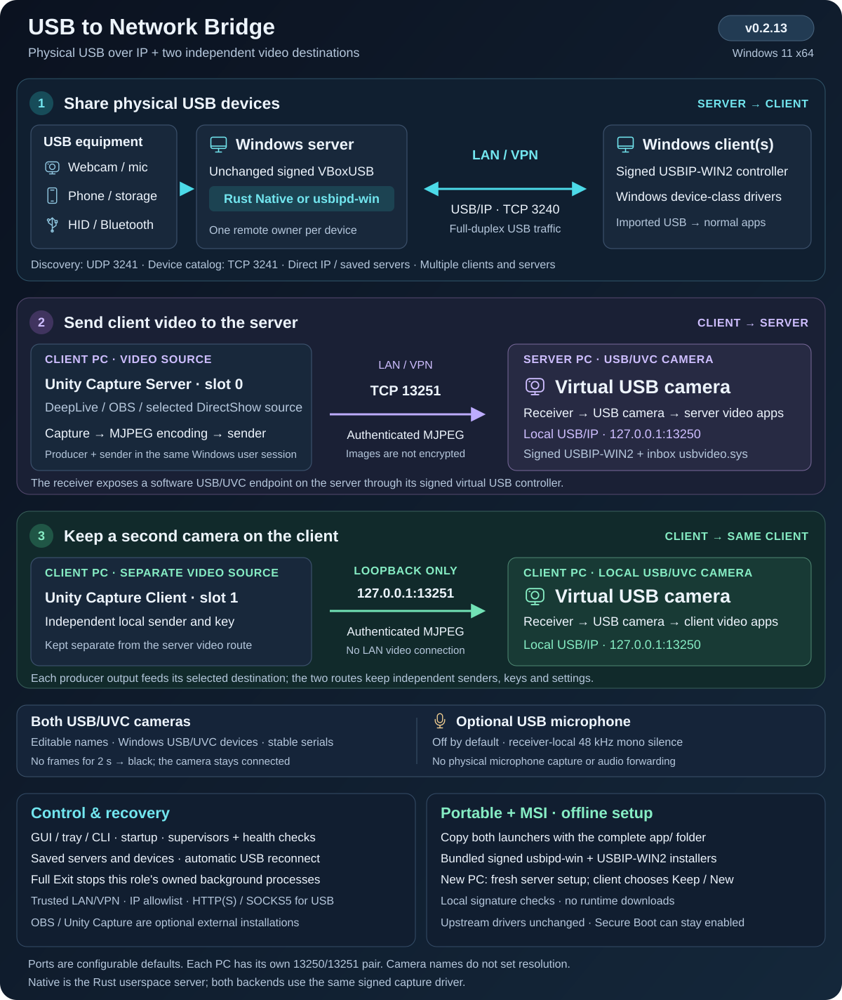
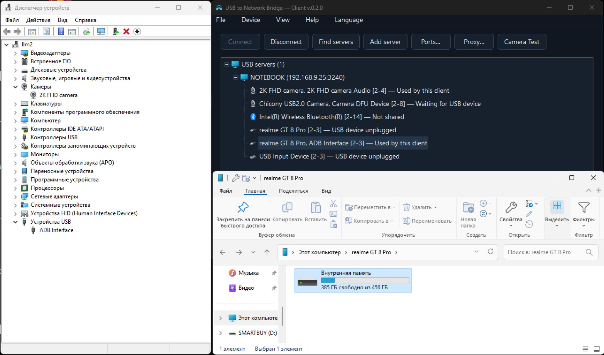
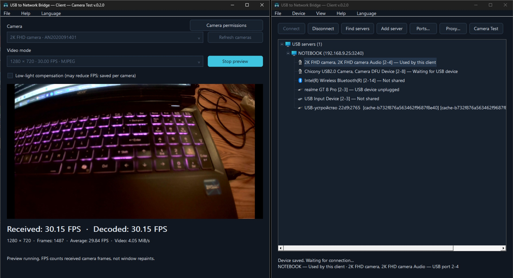

# USB to Network Bridge

[](https://github.com/AlexeySmirnov74/USB-to-Network-Bridge/releases/latest)
[](https://github.com/AlexeySmirnov74/USB-to-Network-Bridge/actions/workflows/ci.yml)
[](https://github.com/AlexeySmirnov74/USB-to-Network-Bridge#quick-start)
[](https://github.com/AlexeySmirnov74/USB-to-Network-Bridge/blob/main/Cargo.toml)
[](https://github.com/AlexeySmirnov74/USB-to-Network-Bridge/blob/main/LICENSE)
[](https://github.com/AlexeySmirnov74/USB-to-Network-Bridge/stargazers)

[English](README.md) · [Français](README.fr.md) · [Русский](README.ru.md) · [Deutsch](README.de.md) · [简体中文](README.zh-CN.md)

An open-source USB over IP (USB/IP) redirector for Windows 11 x64. Share real USB devices between Windows computers over a LAN or VPN, including webcams and Android phone ADB/storage. A Rust server exports selected devices; a Windows client imports them through a virtual USB controller. No activation, trial timer or license-based device limit.

**v0.2.13 — Windows 11 x64.** A Rust USB server and client with a desktop GUI, command-line control, automatic discovery and reconnect, plus an MSI installer and portable ZIP. [Download the latest release](https://github.com/AlexeySmirnov74/USB-to-Network-Bridge/releases/latest).

**Offline setup:** the portable ZIP and MSI include the signed server and client driver installers. Copy both launchers and the entire `app` folder to another Windows 11 x64 PC; first-run installation uses only local files. [Installation](docs/installation.md) · [Driver licenses and source](docs/driver-sources.md).

**Agent health in v0.2.1:** server and client controllers run under separate supervisors. Exited controllers restart automatically; stopped heartbeat progress is detected after two minutes. Independent one-minute scheduled checks also recover a missing or stalled supervisor. Stale reports no longer claim a connected device. Use `usbbridge --config FILE server health` or `client health` to inspect current health. See [changes](CHANGELOG.md).




**v0.2.3:** camera names are synchronized across DirectShow and Media Foundation. Video capture wakes when a frame arrives, reuses bounded working buffers and reports processing timings. For a producer running on the client PC, follow the [OBS/Unity Capture integration guide](docs/third-party-video.md), including command-line examples and a handoff task for another project.

## USB camera from a remote video source

**New in v0.2.2:** send video from a Windows client into a USB/UVC camera on the Windows server. Choose **Server → USB camera — receive video**, set its name (for example `4k web camera`), then configure **Device → Send video** on the client with the source, server address and the same connection key. The server uses the signed USBIP-WIN2 controller and Windows `usbvideo.sys`; the camera has no mandatory Media Foundation name suffix. Installed OBS/Unity Capture sources are selected through DirectShow. See the [video camera quick start](docs/virtual-camera.md).

The video path uses authenticated TCP/MJPEG and retains the USB camera while a lost source reconnects, showing black instead of switching to another camera. Each endpoint has startup recovery and an independent heartbeat check. The name is configurable independently of resolution; 1280×720 at approximately 30 FPS was measured with a real camera source. Use a trusted LAN or VPN: frame authentication does not encrypt the images. The virtual USB controller remains visible in the Windows device tree.

**Optional silent microphone:** each generated USB camera can also expose a USB Audio Class capture input under the same composite device. Enable **Silent microphone** in the receiver camera settings. It always supplies silence; it never captures a real microphone. Select it separately in messenger audio settings if needed. [Setup](docs/dual-camera.md#optional-silent-microphone).

## Two independent video destinations

DeepLive and other producers can use **Unity Capture Server** to feed the server USB camera (for example, `4k web camera`), or **Unity Capture Client** to feed a separate USB camera on the client (default `2k web camera`). Both USB cameras have independent persistent identities and editable names. Configure the client camera under **Device → Client USB camera**. The client route stays on loopback; the server route retains its network destination and connection key. See the [dual camera setup](docs/dual-camera.md).

## What you can do

- Discover servers automatically or add an IP/hostname and port; save multiple servers and reconnect selected devices after a restart or cable reconnection.
- Share and unshare individual devices without restarting unrelated USB sessions. Each device has one remote owner at a time.
- Choose the stock `usbipd-win` server or the Rust `Native` transport. Both use the upstream signed VBoxUSB capture driver. The Windows client uses the upstream signed USBIP-WIN2 virtual controller.
- Use a dark desktop GUI, tray menus, or the [command line](docs/command-line.md). English is the default; French, Russian, German, and Simplified Chinese are included.
- Configure direct access, HTTP CONNECT, HTTPS CONNECT, or SOCKS5 per server, with optional credentials protected locally by Windows DPAPI.
- Test a selected webcam with live received/decoded FPS. On the client, Low-light compensation is saved per camera; enabling it can lower FPS. Camera Test blocks its main window until closed, on both roles.
- Configure Windows startup, ports, IP allowlists, per-device local use while idle, and automatic cleanup of unplugged entries (one day by default).

**“Enabled” in the server table means local use without a client**, independently of Share. Leave it off to reserve a webcam for remote access. Local and remote applications cannot use the same captured device simultaneously.

## usbipd-win and Native Rust

These are two **server backends**, rather than two different kernel drivers. [usbipd-win](https://github.com/dorssel/usbipd-win) provides the upstream USB/IP service and device-management tools; **Native** is this project's own Rust capture and USB/IP server.

| Component | Stock usbipd-win | Native Rust |
| --- | --- | --- |
| Server handling USB traffic | Upstream usbipd-win service, implemented in C#/.NET | Our Rust executable, usbbridge-server.exe |
| Physical USB capture | Upstream production-signed VBoxUSB driver | The same unmodified, production-signed VBoxUSB driver |
| Server data path | USB device → VBoxUSB → usbipd-win service → TCP | USB device → VBoxUSB → Rust server → TCP |
| Transfer implementation | Maintained by the upstream usbipd-win project | Direct asynchronous IOCTL/IOCP capture, pipelined requests, bounded buffers/queues and TCP_NODELAY |
| Windows client | Our client controls the signed USBIP-WIN2 virtual controller | The same client and USBIP-WIN2 controller |
| Dependency on usbipd-win | Supplies the stock server and device management | Still needed for installation, inventory and device reservation; its service does not forward Native USB traffic |

Native lets us tune the USB/network path directly. For example, initializing the capture driver's device-speed information before claiming a camera restored approximately **30 FPS** for the tested Chicony 1280 × 720 MJPEG mode. This is a measured device-specific result, not a guarantee that Native is faster for every device. See [performance measurements](docs/performance.md) and [architecture](docs/architecture.md).

Discovery, GUI/tray controls, saved selections, automatic reconnect and proxy support belong to USB to Network Bridge and are available with either backend. Switch the backend in server Settings; switching reconnects active devices. Neither backend requires Test Signing or replacing the signed kernel driver.

## Screenshots

### Android phone connected on the Windows client



The client has imported a realme GT 8 Pro. Windows exposes its ADB interface and internal storage on the remote computer.

### Webcam preview and FPS on the Windows client



1280 × 720 MJPEG in the 30 FPS mode. Camera Test shows **30.15 received FPS and 30.15 decoded FPS**, with a **29.84 FPS average**; Low-light compensation is off.

For a concise product description and common use cases, see the [project FAQ](docs/project-overview.md).

## Quick start

You need two Windows 11 x64 computers, administrator access for driver/setup operations, and a trusted network or VPN. Secure Boot can remain enabled: no test signing is required for the upstream drivers. Only publish devices that may be handed over to another computer; capturing a mouse, keyboard, or disk removes its local availability.

### 1. Get and open the applications

Download the MSI or complete portable ZIP from [Releases](https://github.com/AlexeySmirnov74/USB-to-Network-Bridge/releases/latest). The [installation guide](docs/installation.md) covers both layouts and moving a portable copy to another PC. Developer builds are available from successful [CI runs](https://github.com/AlexeySmirnov74/USB-to-Network-Bridge/actions/workflows/ci.yml).

Extract the complete portable ZIP, for example to `C:\USBBridge`. Its root has only two launchers and the support folder:

```text
USB-to-Network-Bridge-Server.exe
USB-to-Network-Bridge-Client.exe
app/
```

Double-click **`USB-to-Network-Bridge-Server.exe`** or **`USB-to-Network-Bridge-Client.exe`**. The MSI Start menu shortcuts use these same launchers. Keep `app` with them: it contains the internal executables, PowerShell helpers, documentation and licenses. The command-line tool is `app\usbbridge.exe`; individual launcher downloads need the complete matching package.

The launcher checks the selected role's required drivers automatically. Missing drivers are installed from the verified local installers in `app\tools\driver-installers`; setup and repair do not download anything. Keep the complete folder when copying to a new PC. Approve UAC when required, and restart Windows manually if requested. Secure Boot and driver signature settings are retained. Existing driver installations and role settings are reused.

### 2. Start the server

Open the Server launcher on the PC with physical USB devices. A fresh server starts disabled, with only loopback allowed and no devices shared. In **Settings**, enter the actual client LAN/VPN IP addresses; enable the server, then right-click a device → **Share**, or double-click an unshared row. Choose **Native** or **usbipd-win** in server Settings; changing the backend reconnects active devices.

### 3. Start the client

Open the Client launcher on the remote PC. Choose **Find servers**, select a server and shared device, then **Connect**. Use **Add server** with the server's IP/hostname and ports when discovery cannot cross the network. Choices are saved and reconnect automatically; **Disconnect** cancels the corresponding choice. Selecting a server node pauses/resumes its remembered devices independently of other servers.

When a configured portable client is copied to a different PC, choose whether to **keep saved server connections** or **start with new settings**; Cancel changes nothing. Keeping connections retains server/device selections and preferences, but machine-bound credentials and local-camera bindings must be configured again. A server copied to a different PC receives fresh machine-specific setup. See [moving a portable copy](docs/installation.md#moving-a-portable-copy-to-another-pc).

Settings use paths relative to their JSON file; `@app` identifies the current application directory. To move an existing deployment on the same Windows installation, close the applications, move both launchers with the complete `app` folder, then open the required launcher. A one-time UAC request updates owned startup tasks, firewall rules and shortcuts while preserving settings, camera identities and keys. Windows registrations use full paths and are updated automatically.

### 4. Check the connection

Open the remote device in its normal Windows application. For a webcam, right-click it → **Camera Test**. A local test on the server requires the camera to be available locally; a camera captured remotely must be tested on the client. A camera without a stable unique USB identity may need to be selected again after moving ports.

| Connection | Default | Purpose |
| --- | --- | --- |
| TCP | 3240 | USB/IP device data |
| UDP | 3241 | Server discovery on local IPv4 networks |
| TCP | 3241 | Full device catalog and status |

Ports can be changed to **1–65535**. The USB data and catalog ports must differ. Match the discovery/catalog port on clients; a proxy must permit both TCP ports. UDP discovery does not traverse a proxy.

## Operation and diagnostics

Choose **File → Exit application** or **tray icon → Exit application** to stop that role completely, including its USB connections and video processes. Health checks respect this choice until the role is reopened or Windows restarts; saved startup settings are retained. Closing the window keeps background work running.

Closing the GUI leaves background work running. Startup tasks restore the server/client after Windows starts, including before user logon; an interactive tray appears after logon. One instance of each role is allowed per computer. Disable startup with `Set-Autostart.ps1 -Role Server` (or `Client`) using the same runtime/config arguments and `-Disable`.

Detailed rotating development logs are stored in `logs\*.debug.jsonl` beside the configuration: UI actions, USB identities/ports, reconnects, and errors. Video images, USB payloads, and passwords are not logged. Logs can still contain IP addresses, local paths, and device serial numbers; review them before posting publicly.

Short network interruptions trigger recovery, not an unlimited guarantee of USB session continuity. Long outages or physical removal can require a device re-enumeration. USB/IP has no built-in encryption or authenticated server identity here: use a trusted LAN/VPN and restrict the firewall/IP allowlist. Do not expose the data/catalog ports directly to the Internet. HTTPS proxy mode encrypts the client-to-proxy hop only.

## Build from source

Requirements: Windows x64, Rust stable (MSVC target, `rustfmt`, `clippy`), MSVC C++ Build Tools, and a Windows SDK. Optional `Bootstrap.ps1` installs a local Rust toolchain; `-InstallBuildTools` additionally installs Microsoft build tools.

```powershell
git clone https://github.com/AlexeySmirnov74/USB-to-Network-Bridge.git
Set-Location USB-to-Network-Bridge
.\Build.ps1
.\Download-Drivers.ps1 -Role Both
.\Package.ps1
```

`Build.ps1` checks formatting, runs Clippy and tests, and builds seven release executables. Developers run `Download-Drivers.ps1 -Role Both` once with internet access before packaging. `Package.ps1` creates `dist\USB-to-Network-Bridge-0.2.13-windows-x64.zip` including both original signed driver installers, runtime helpers, examples, docs and dependency licenses. SHA-256 and offline Authenticode checks use `driver-installers.json`. CI downloads the pinned inputs at build time and packages them without installing USB drivers; hardware tests remain separate.

## Installation and runtime

The current package **still requires Windows PowerShell 5.1 and the supplied runtime `.ps1` helpers**. They implement privileged publication/capture, backend switching, firewall configuration, and startup tasks. `Build.ps1`, `Bootstrap.ps1`, and packaging scripts are development tools and are not needed on an installed client/server. A future native service can replace runtime scripts; deleting them now breaks the application.

The project EXEs and MSI are unsigned. USB drivers retain their official production signatures; Secure Boot and memory integrity can remain enabled. The MSI supports installation, repair, upgrade, rollback and uninstall. See [installation](docs/installation.md) and [building and releasing](docs/production-readiness.md).

## Documentation and license

[Architecture](docs/architecture.md) · [CLI](docs/command-line.md) · [Camera testing](docs/camera-preview.md) · [Performance](docs/performance.md) · [Hardware tests](docs/hardware-tests.md) · [Device identifiers](docs/device-identifiers.md) · [Memory audit](docs/memory-audit.md)

Some detailed engineering notes are currently in Russian. The quick start above and the translated READMEs are maintained together.

Project code: [MIT](LICENSE). Dependencies and external drivers retain their own licenses: [third-party notices](THIRD-PARTY.txt). Local configurations, logs, device inventories, credentials and signing keys are excluded from public packages.
