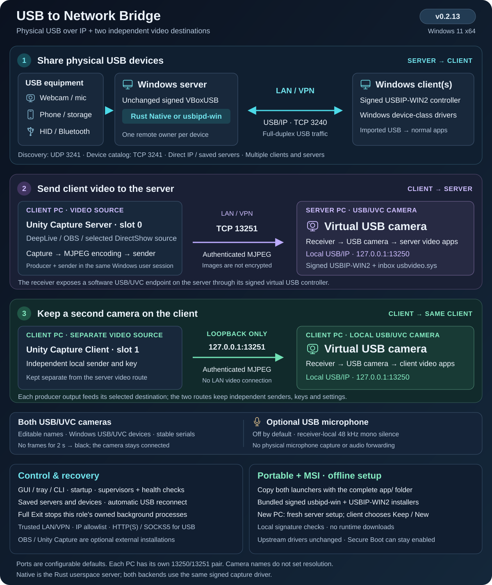
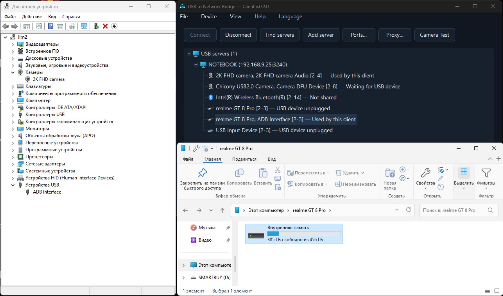
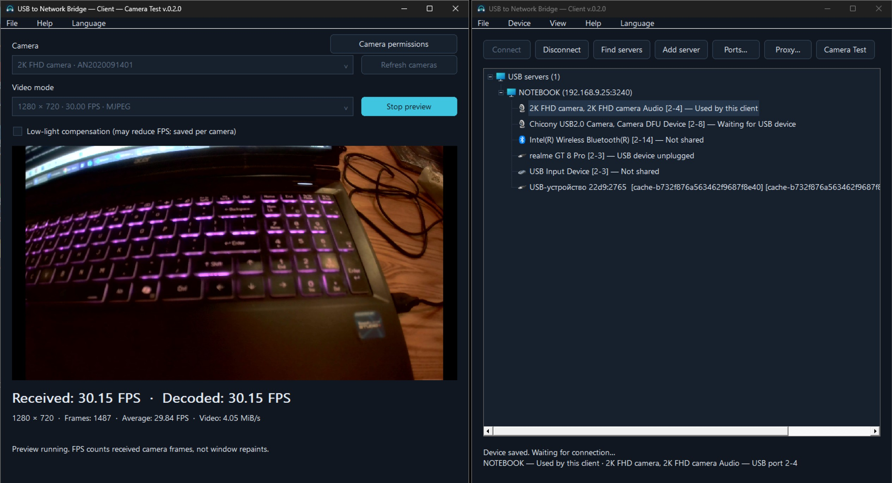

# USB to Network Bridge

[](https://github.com/AlexeySmirnov74/USB-to-Network-Bridge/releases/latest)
[](https://github.com/AlexeySmirnov74/USB-to-Network-Bridge/actions/workflows/ci.yml)
[](https://github.com/AlexeySmirnov74/USB-to-Network-Bridge#quick-start)
[](https://github.com/AlexeySmirnov74/USB-to-Network-Bridge/blob/main/Cargo.toml)
[](https://github.com/AlexeySmirnov74/USB-to-Network-Bridge/blob/main/LICENSE)
[](https://github.com/AlexeySmirnov74/USB-to-Network-Bridge/stargazers)

[English](README.md) · [Français](README.fr.md) · [Русский](README.ru.md) · [Deutsch](README.de.md) · [简体中文](README.zh-CN.md)

Открытый USB-редиректор для Windows 11 x64: USB over IP (USB/IP) по локальной сети или VPN. Передавайте настоящие USB-устройства между компьютерами Windows, включая веб-камеры и ADB/память телефона Android. Сервер Rust публикует выбранные устройства, клиент подключает их через виртуальный USB-контроллер. Нет активации, trial-таймера и лицензионного лимита устройств.

**v0.2.11 — Windows 11 x64.** Сервер и клиент USB на Rust с графическим интерфейсом, командной строкой, автоматическим поиском и переподключением, установщиком MSI и переносимым ZIP. [Скачать последнюю версию](https://github.com/AlexeySmirnov74/USB-to-Network-Bridge/releases/latest).

**Автономная установка:** ZIP и MSI содержат подписанные установщики драйверов сервера и клиента. Перенесите оба EXE и всю папку `app` на другой ПК с Windows 11 x64 — первая установка использует локальные файлы. [Установка](docs/installation.md) · [Лицензии и исходники драйверов](docs/driver-sources.md).

**Проверки агентов в v0.2.1:** контроллеры сервера и клиента работают под отдельными супервизорами. Завершившийся контроллер перезапускается автоматически, остановка heartbeat обнаруживается через две минуты. Независимые задачи Windows раз в минуту восстанавливают также отсутствующий или зависший супервизор. Устаревший отчёт больше не показывает устройство подключённым. Проверка состояния: `usbbridge --config FILE server health` или `client health`. [Что изменилось](CHANGELOG.md).




**v0.2.3:** имя камеры синхронизируется для DirectShow и Media Foundation. Захват пробуждается при готовности кадра, рабочие буферы используются повторно с ограничением размера, доступны тайминги обработки. Для приложения-источника на ПК клиента добавлена [инструкция OBS/Unity Capture](docs/third-party-video.ru.md) с CLI и заданием для другого проекта.

## USB-камера из удалённого видеопотока

**Новое в v0.2.2:** видео с Windows-клиента можно передать в USB/UVC-камеру на Windows-сервере. Выберите **Сервер → USB-камера — приём видео**, задайте имя (например `4k web camera`), затем на клиенте откройте **Устройство → Передача видео** и укажите источник, адрес сервера и одинаковый ключ подключения. Используются подписанный контроллер USBIP-WIN2 и штатный `usbvideo.sys`; обязательной приписки Media Foundation к имени нет. Установленные источники OBS/Unity Capture выбираются через DirectShow. [Быстрый старт видеокамеры](docs/virtual-camera.md).

Поток передаётся через TCP/MJPEG с проверкой подлинности кадров. При пропадании источника USB-камера остаётся подключённой и показывает чёрный кадр; восстановление выполняется автоматически. Для видеомодулей предусмотрены автозапуск и отдельная проверка heartbeat. Имя не задаёт разрешение: на реальном источнике измерено около 30 FPS при 1280×720. Используйте доверенную LAN или VPN: проверка подлинности не шифрует изображение. Виртуальный USB-контроллер виден в дереве устройств Windows.

**Необязательный микрофон с тишиной:** в настройках каждой виртуальной USB-камеры можно включить **«Микрофон (тишина)»**. Он появится как аудиовход того же составного USB-устройства и всегда будет выдавать тишину, без захвата настоящего микрофона. При необходимости выберите его отдельно в аудионастройках мессенджера. [Настройка](docs/dual-camera.md#optional-silent-microphone).

## Два независимых направления видео

В DeepLive **Unity Capture Server** направляет видео в USB-камеру сервера (например, `4k web camera`), а **Unity Capture Client** — в отдельную USB-камеру клиента (`2k web camera` по умолчанию). У камер независимые постоянные идентификаторы и изменяемые имена. Настройка клиентской камеры: **Устройство → USB-камера клиента**. Клиентский маршрут использует только loopback; адрес и ключ серверного маршрута сохраняются. [Настройка двух камер](docs/dual-camera.md).

## Возможности

- Автопоиск или прямой IP/имя и порт; несколько сохранённых серверов и автоматическое восстановление устройств после перезапуска или возврата кабеля.
- Публикация отдельных устройств без перезапуска остальных сеансов. Одним устройством одновременно владеет один удалённый клиент.
- Переключение между `Native` (сервер Rust) и `usbipd-win`. Оба используют официальный подписанный VBoxUSB; клиент — подписанный виртуальный контроллер USBIP-WIN2.
- Тёмный GUI, трей и [CLI](docs/command-line.md). Язык по умолчанию английский; доступны русский, французский, немецкий и упрощённый китайский.
- HTTP CONNECT, HTTPS CONNECT и SOCKS5; пароль защищён локально Windows DPAPI.
- Camera Test с FPS. На клиенте Low-light compensation сохраняется отдельно для каждой камеры; включение может снижать FPS. Окно теста блокирует главное окно обеих ролей до закрытия.
- Автозагрузка Windows, настраиваемые порты/IP, локальное использование без клиента, удаление отключённых записей через один день по умолчанию.

Колонка **Enabled / Включено** разрешает локальное использование без клиента и независима от **Share / Опубликовать**. Для постоянного резервирования камеры оставьте флажок выключенным. Одновременное локальное и удалённое использование захваченного устройства не поддерживается.

## Отличия usbipd-win и Native Rust

Это два **серверных модуля**, а не два разных драйвера ядра. [usbipd-win](https://github.com/dorssel/usbipd-win) предоставляет штатную службу USB/IP и управление устройствами; **Native** — наш собственный модуль захвата и сервер USB/IP на Rust.

| Компонент | Штатный usbipd-win | Native Rust |
| --- | --- | --- |
| Сервер передачи USB | Служба usbipd-win на C#/.NET | Наш процесс usbbridge-server.exe на Rust |
| Захват физического USB | Официальный подписанный драйвер VBoxUSB | Тот же подписанный VBoxUSB без изменений |
| Путь данных на сервере | USB → VBoxUSB → служба usbipd-win → TCP | USB → VBoxUSB → сервер Rust → TCP |
| Передача запросов | Реализация вышестоящего проекта usbipd-win | Прямые асинхронные IOCTL/IOCP, запросы в конвейере, ограниченные буферы и очереди, TCP_NODELAY |
| Клиент Windows | Наш клиент управляет подписанным USBIP-WIN2 | Тот же клиент и контроллер USBIP-WIN2 |
| Зависимость от usbipd-win | Штатный сервер и управление устройствами | Нужен для установки, инвентаризации и резервирования; его служба не передаёт USB-трафик Native |

Native позволяет непосредственно настраивать путь USB/сеть. Например, инициализация скорости устройства в драйвере перед захватом вернула около **30 FPS** на проверенной Chicony в режиме 1280 × 720 MJPEG. Это результат для конкретной камеры, а не обещание превосходства на любом устройстве. Подробнее: [измерения](docs/performance.md) и [архитектура](docs/architecture.md).

Поиск серверов, GUI/трей, сохранение выбора, переподключение и прокси реализованы самим USB to Network Bridge и доступны с обоими модулями. Модуль переключается в настройках сервера; при переключении активные устройства переподключаются. Test Signing и замена подписанного драйвера ядра не требуются.

## Скриншоты

### Подключение телефона Android на клиенте Windows



Клиент подключил realme GT 8 Pro. На удалённом компьютере Windows видны интерфейс ADB и внутренняя память телефона.

### Просмотр камеры и FPS на клиенте Windows



Режим 1280 × 720 MJPEG, 30 FPS. В Camera Test видны **30,15 FPS при приёме и декодировании**, среднее — **29,84 FPS**. Low-light compensation выключен.

Краткое описание назначения и сценариев использования: [FAQ о проекте на английском](docs/project-overview.md).

## Быстрый старт

Нужны два ПК Windows 11 x64, права администратора для настройки и доверенная сеть/VPN. Secure Boot можно оставить включённым; тестовая подпись для официальных драйверов не нужна. Захват мыши, клавиатуры или диска временно лишает сервер локального доступа к этому устройству.

Скачайте MSI или полный portable ZIP из [Releases](https://github.com/AlexeySmirnov74/USB-to-Network-Bridge/releases/latest). Распакуйте весь архив, например в `C:\USBBridge`. В корне находятся только два файла запуска и папка компонентов:

```text
USB-to-Network-Bridge-Server.exe
USB-to-Network-Bridge-Client.exe
app/
```

Запускайте **`USB-to-Network-Bridge-Server.exe`** на сервере и **`USB-to-Network-Bridge-Client.exe`** на клиенте. Те же файлы открываются ярлыками MSI в меню «Пуск». Папку `app` оставляйте рядом: внутри рабочие EXE, `.ps1`, документация и лицензии. Командная строка — `app\usbbridge.exe`; отдельно скачанные файлы запуска требуют полного пакета той же версии.

Запуск автоматически проверяет необходимые драйверы выбранной роли. Недостающие драйверы устанавливаются из проверенных локальных установщиков в `app\tools\driver-installers`: установка и восстановление ничего не скачивают. На новый ПК копируйте всю папку вместе с `app`. При необходимости разрешите UAC; если потребуется перезагрузка Windows, выполните её вручную. Secure Boot и режим подписи сохраняются. Установленные драйверы и настройки роли используются повторно.

На новом **сервере** работа изначально выключена, разрешён только loopback и ничего не опубликовано. Укажите настоящие LAN/VPN IP клиентов в **Settings**, включите сервер, затем правой кнопкой → **Share** или двойным щелчком опубликуйте нужные устройства. Модуль Native/usbipd-win выбирается в настройках; его смена переподключает активные устройства.

При переносе настроенного portable **клиента** на другой ПК появится выбор: сохранить подключения к серверам или начать с новыми настройками. Отмена ничего не меняет. При сохранении остаются серверы, выбор устройств и предпочтения; привязанные к прежней Windows секреты и локальную камеру нужно настроить заново. Сервер на другом ПК проходит новую настройку для этой машины. [Подробности переноса](docs/installation.md#moving-a-portable-copy-to-another-pc).

Пути в настройках отсчитываются от соответствующего JSON; `@app` обозначает текущую папку приложения. Для переноса в другую папку на той же Windows закройте приложения, перенесите оба EXE вместе со всей папкой `app` и откройте нужный EXE. Однократный запрос UAC обновит принадлежащие установке задания автозагрузки, правила брандмауэра и ярлыки, сохранив настройки, идентификаторы камер и ключи. Системные привязки Windows используют полные пути и обновляются автоматически.

Для полной остановки выберите **Файл → Выход из приложения** или **значок в трее → Выход из приложения**. Остановятся USB-подключения и видеопроцессы выбранной роли. Проверки здоровья не возобновят её до повторного запуска приложения или перезагрузки Windows; настройка автозагрузки сохранится. Закрытие окна оставляет фоновые процессы работающими.

Нажмите **Find servers**, выберите сервер, опубликованное устройство и **Connect**. Для другой подсети используйте **Add server** с LAN/VPN-адресом. Выбор запоминается; **Disconnect** отменяет автоподключение. На узле сервера можно приостановить все его устройства независимо от остальных серверов.

Для камеры: правое меню → **Camera Test**. Локальный тест на сервере требует локально доступной камеры; захваченную удалённо камеру проверяйте на клиенте. Без уникальной постоянной USB-идентичности после смены порта иногда нужен повторный выбор.

| Канал | По умолчанию | Назначение |
| --- | --- | --- |
| TCP | 3240 | USB/IP |
| UDP | 3241 | Автопоиск в локальных IPv4-сетях |
| TCP | 3241 | Список устройств и состояние |

Порты: **1–65535**, порт данных должен отличаться от порта списка/поиска. На клиентах задайте тот же порт поиска. Прокси должен разрешать оба TCP-порта; UDP-поиск через него не передаётся.

## Эксплуатация и сборка

Закрытие GUI оставляет фоновые задачи работать. Автозапуск восстанавливает соединения до входа пользователя; трей появляется после входа. Один экземпляр каждой роли на Windows. Отключение автозапуска: та же команда `Set-Autostart.ps1` с прежними путями и `-Disable`.

Журналы: `logs\*.debug.jsonl` рядом с конфигурацией, с ротацией. Изображения, USB-данные и пароли не записываются; IP, пути и серийные номера могут присутствовать. Проверьте их перед публичной отправкой. USB/IP здесь не шифруется и не проверяет личность сервера: используйте LAN/VPN и IP-фильтры, не открывайте порты в Интернет. HTTPS-прокси шифрует только участок клиент–прокси. Длительный обрыв может вызвать повторную USB-нумерацию; непрерывность любого сеанса не гарантируется.

Для сборки нужны Rust stable MSVC, `rustfmt`, `clippy`, MSVC C++ Build Tools и Windows SDK:

```powershell
git clone https://github.com/AlexeySmirnov74/USB-to-Network-Bridge.git
Set-Location USB-to-Network-Bridge
.\Build.ps1
.\Download-Drivers.ps1 -Role Both
.\Package.ps1
```

ZIP появится в `dist`; внутри оба оригинальных подписанных установщика драйверов, EXE, рабочие сценарии, примеры и лицензии. Разработчик один раз выполняет `Download-Drivers.ps1 -Role Both` с интернетом перед упаковкой. SHA-256 и цифровая подпись проверяются локально по `driver-installers.json`. CI загружает закреплённые зависимости при сборке, но не устанавливает драйверы и не заменяет аппаратные проверки. Необязательный `Bootstrap.ps1` устанавливает Rust; `-InstallBuildTools` добавляет инструменты Microsoft.

**PowerShell 5.1 и рабочие `.ps1` обязательны** для публикации, захвата, переключения модулей и автозапуска. Сценарии сборки на установленном ПК не нужны. Свои EXE и MSI выпускаем без Authenticode; официальные подписи USB-драйверов сохраняются. MSI поддерживает установку, восстановление, обновление, откат и удаление. [Установка](docs/installation.md) · [Сборка и выпуск](docs/production-readiness.md).

[Архитектура](docs/architecture.md) · [CLI](docs/command-line.md) · [Камеры](docs/camera-preview.md) · [Производительность](docs/performance.md) · [Аппаратные испытания](docs/hardware-tests.md) · [Идентификаторы](docs/device-identifiers.md) · [Память](docs/memory-audit.md)

Код проекта — [MIT](LICENSE); зависимости и внешние драйверы сохраняют свои [лицензии](THIRD-PARTY.txt). Локальные настройки, журналы, инвентарь устройств, пароли и ключи подписи не входят в публичные пакеты.
