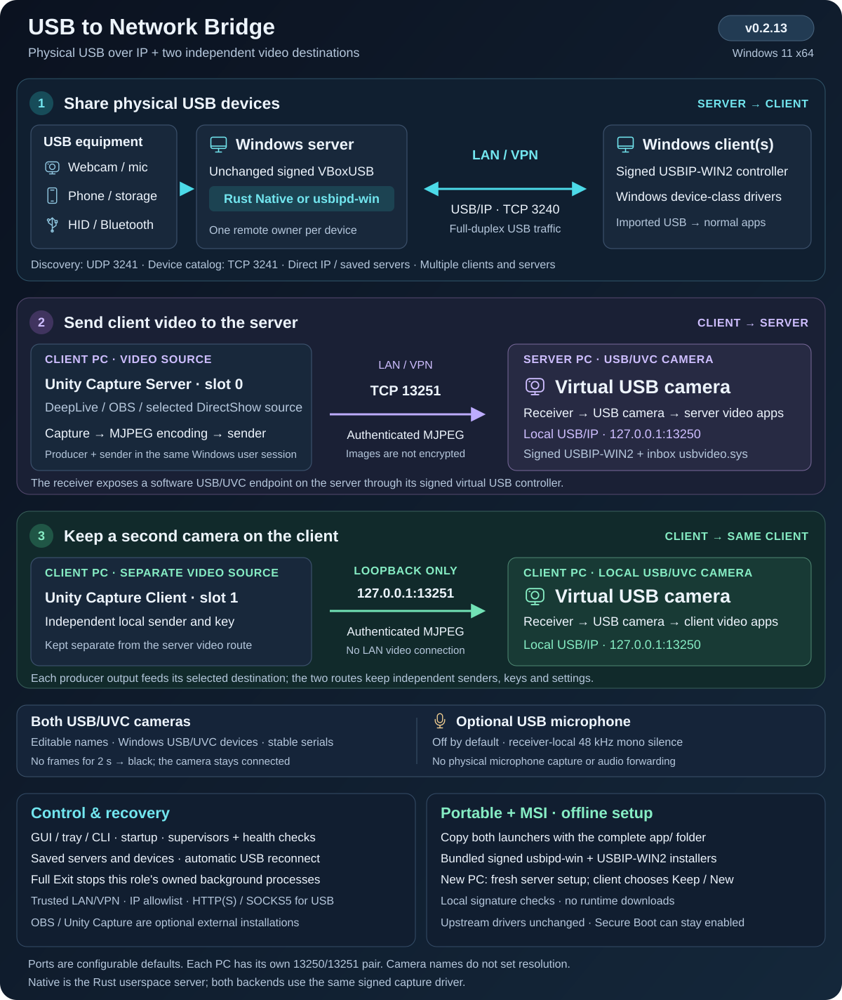
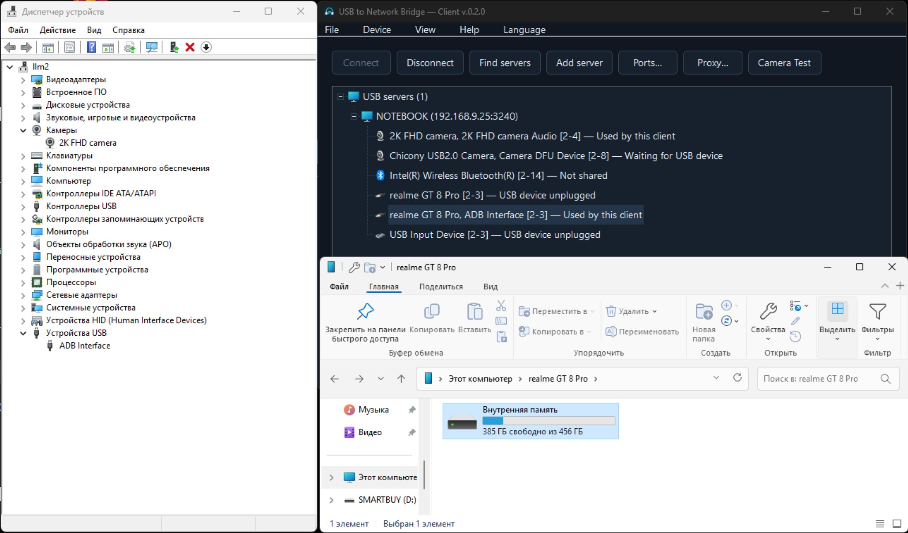
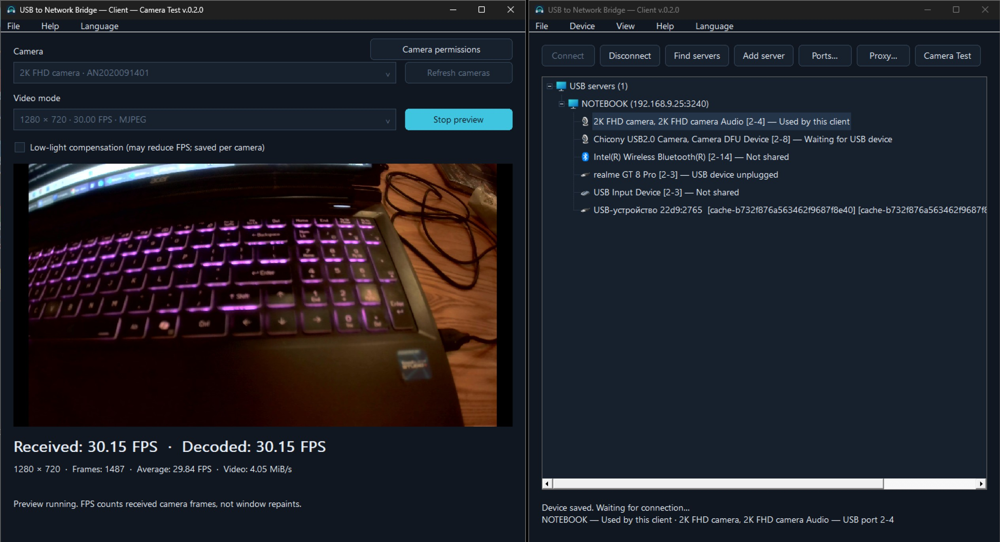

# USB to Network Bridge

[](https://github.com/AlexeySmirnov74/USB-to-Network-Bridge/releases/latest)
[](https://github.com/AlexeySmirnov74/USB-to-Network-Bridge/actions/workflows/ci.yml)
[](https://github.com/AlexeySmirnov74/USB-to-Network-Bridge#quick-start)
[](https://github.com/AlexeySmirnov74/USB-to-Network-Bridge/blob/main/Cargo.toml)
[](https://github.com/AlexeySmirnov74/USB-to-Network-Bridge/blob/main/LICENSE)
[](https://github.com/AlexeySmirnov74/USB-to-Network-Bridge/stargazers)

[English](README.md) · [Français](README.fr.md) · [Русский](README.ru.md) · [Deutsch](README.de.md) · [简体中文](README.zh-CN.md)

面向 Windows 11 x64 的开源 USB over IP（USB/IP）重定向工具。通过局域网或 VPN 在 Windows 计算机间共享真实 USB 设备，包括摄像头和 Android 手机的 ADB 接口/存储。Rust 服务器导出选定设备，Windows 客户端通过虚拟 USB 控制器导入。无需激活，没有试用倒计时，也没有许可证规定的设备数量限制。

**v0.2.6：Windows 11 x64。** 使用 Rust 编写的 USB 服务器和客户端，提供图形界面、命令行、自动发现与重连、MSI 安装包及便携 ZIP。[下载最新版本](https://github.com/AlexeySmirnov74/USB-to-Network-Bridge/releases/latest)。

**v0.2.1 代理健康检查：**服务器和客户端控制器分别由监控程序管理。退出的控制器会自动重启；心跳停止两分钟后会被检测到。独立的 Windows 任务每分钟还会检查并恢复监控程序。过期状态不再显示设备已连接。诊断命令：`usbbridge --config FILE server health` 或 `client health`。[更新记录](CHANGELOG.md)。




**v0.2.3：** 摄像头名称在 DirectShow 与 Media Foundation 之间同步。捕获在新帧到达时唤醒，重复使用有容量限制的工作缓冲区，并报告处理耗时。客户端电脑上的第三方视频应用可参考 [OBS/Unity Capture 集成指南](docs/third-party-video.md)（英文），其中包括命令行示例及其他项目的集成任务说明。

## 将远程视频源转换为 USB 摄像头

**v0.2.2 新功能：** 将 Windows 客户端的视频发送到 Windows 服务器上的 USB/UVC 摄像头。在服务器选择 **服务器 → USB 摄像头 — 接收视频** 并设置名称，例如 `4k web camera`；在客户端选择 **设备 → 发送视频**，设置视频源、服务器地址和相同的连接密钥。摄像头使用已签名的 USBIP-WIN2 控制器和 Windows 自带的 `usbvideo.sys`，无需 Media Foundation 强制添加的名称后缀。已安装的 OBS/Unity Capture 视频源通过 DirectShow 选择。[视频摄像头快速入门](docs/virtual-camera.md)。

视频通过具有身份验证的 TCP/MJPEG 传输。视频源中断时，USB 摄像头保持连接并显示黑色画面，随后自动恢复；两个模块均支持自动启动和独立心跳检查。名称与分辨率独立；使用真实摄像头源测试时，1280×720 约为 30 FPS。请使用可信局域网或 VPN：身份验证不会加密图像。Windows 设备树中仍然可以识别虚拟 USB 控制器。

**可选静音麦克风：** 在接收端摄像头设置中启用 **Silent microphone**，即可为同一复合 USB 设备添加音频输入。它始终输出静音，不采集真实麦克风。必要时请在通信应用的音频设置中单独选择它。[配置说明](docs/dual-camera.md#optional-silent-microphone)。

## 两个独立的视频目标

**Unity Capture Server** 将视频发送到服务器的 USB 摄像头（例如 `4k web camera`）；**Unity Capture Client** 将视频发送到客户端独立的 USB 摄像头（默认名为 `2k web camera`）。两台摄像头有独立的持久标识，名称均可修改。通过 **Device → Client USB camera** 配置客户端摄像头。本地路径仅使用回环连接，服务器地址和连接密钥保持独立。[配置说明](docs/dual-camera.md)。

## 功能

- 自动发现服务器，或直接输入 IP/主机名及端口；保存多台服务器，并在重启或重新插入设备后自动连接。
- 单独共享或取消共享设备，无需重启其他 USB 会话；每台设备同一时间由一个远程客户端独占。
- 可切换 Rust `Native` 传输模块与 `usbipd-win`。两者均使用上游签名的 VBoxUSB 驱动，客户端使用上游签名的 USBIP-WIN2 虚拟控制器。
- 深色 GUI、托盘菜单和[命令行](docs/command-line.md)。默认英语，支持法语、俄语、德语及简体中文。
- 每台服务器可使用直连、HTTP CONNECT、HTTPS CONNECT 或 SOCKS5；凭据在本机由 Windows DPAPI 保护。
- **Camera Test** 显示接收与解码 FPS。客户端按摄像头保存低光补偿设置；启用此设置可能降低帧率。两种角色的测试窗口都会阻止操作主窗口，直到关闭测试。
- 支持 Windows 启动后自动运行、自定义端口/IP 白名单、无客户端时本地使用，以及默认一天后清理未重新出现的拔出设备记录。

服务器表格中的 **Enabled** 允许在没有客户端时本地使用设备，与 **Share** 相互独立。若要将摄像头一直保留给远程使用，请勿勾选。已捕获的设备无法同时供本地和远程程序使用。

## usbipd-win 与 Native Rust 的区别

这是两个**服务器后端**，而不是两个不同的内核驱动。[usbipd-win](https://github.com/dorssel/usbipd-win) 提供上游 USB/IP 服务和设备管理工具；**Native** 是本项目自行实现的 Rust USB 捕获模块和 USB/IP 服务器。

| 组件 | 标准 usbipd-win | Native Rust |
| --- | --- | --- |
| USB 数据服务器 | 使用 C#/.NET 编写的 usbipd-win 服务 | 本项目的 Rust 程序 usbbridge-server.exe |
| 物理 USB 捕获 | 上游正式签名的 VBoxUSB 驱动 | 同一个未经修改的正式签名 VBoxUSB 驱动 |
| 服务器数据路径 | USB → VBoxUSB → usbipd-win 服务 → TCP | USB → VBoxUSB → Rust 服务器 → TCP |
| 传输实现 | 由 usbipd-win 上游项目维护 | 直接异步 IOCTL/IOCP 捕获、流水线请求、有界缓冲区与队列、TCP_NODELAY |
| Windows 客户端 | 本项目客户端控制已签名的 USBIP-WIN2 虚拟控制器 | 相同的客户端和 USBIP-WIN2 控制器 |
| 对 usbipd-win 的依赖 | 提供标准服务器和设备管理 | 仍用于安装、设备清单和保留；其服务不转发 Native USB 数据 |

Native 让我们能够直接优化 USB/网络路径。例如，在捕获前初始化驱动中的设备速度信息，使测试用 Chicony 摄像头在 1280 × 720 MJPEG 模式下恢复到约 **30 FPS**。这是特定设备上的测量结果，不代表 Native 对所有设备都更快。参见[性能测量](docs/performance.md)和[架构](docs/architecture.md)。

自动发现、图形界面/托盘、保存选择、自动重连和代理支持由 USB to Network Bridge 提供，两种后端均可使用。在服务器设置中切换后端时，活动设备会重新连接。无需 Test Signing，也无需替换已签名的内核驱动。

## 截图

### Windows 客户端连接 Android 手机



客户端已导入 realme GT 8 Pro，远程 Windows 计算机可以访问其 ADB 接口和内部存储。

### Windows 客户端摄像头预览与 FPS



1280 × 720 MJPEG、30 FPS 模式。Camera Test 显示**接收和解码均为 30.15 FPS，平均 29.84 FPS**；低光补偿已关闭。

简要介绍和使用场景请参阅[英文项目 FAQ](docs/project-overview.md)。

## 快速开始

需要两台 Windows 11 x64 计算机、安装/配置所需的管理员权限，以及可信局域网或 VPN。可以保持 Secure Boot 开启；官方驱动无需测试签名模式。捕获鼠标、键盘或磁盘会暂时使服务器无法在本地使用该设备。

从成功的 [GitHub Actions 工作流](https://github.com/AlexeySmirnov74/USB-to-Network-Bridge/actions/workflows/ci.yml)下载 `usbbridge-windows-x64` 构件（可能需要登录 GitHub），或按下文从源码构建。在两台计算机上将应用 ZIP 解压至 `C:\USBBridge`。请将 `.ps1` 与 EXE 保存在同一目录。

完成配置后，在服务器上双击 **`USB-to-Network-Bridge-Server.exe`**，在客户端上双击 **`USB-to-Network-Bridge-Client.exe`**。它们会使用已保存的设置打开相应 GUI，不显示控制台窗口。请将这些 EXE 保留在完整的应用目录中。MSI 的开始菜单快捷方式也使用这两个启动器；`usbbridge.exe` 仍用于命令行管理。

[下载服务器 EXE](https://github.com/AlexeySmirnov74/USB-to-Network-Bridge/releases/latest/download/USB-to-Network-Bridge-Server.exe) · [下载客户端 EXE](https://github.com/AlexeySmirnov74/USB-to-Network-Bridge/releases/latest/download/USB-to-Network-Bridge-Client.exe)。单独下载的 EXE 应放在上述完整的应用目录中。

在连接物理设备的**服务器**上，以**管理员身份运行 Windows PowerShell**：

```powershell
Set-Location C:\USBBridge
.\Install-ProductionDrivers.ps1 -Role Server -AllowedPeer 192.0.2.10
Copy-Item .\server.example.psd1 .\server.local.psd1
notepad .\server.local.psd1
```

在命令和配置的 `AllowedPeers` 中，将示例 IP 改为真实客户端地址。首次启动保留 `Export = @()`。如果安装程序要求重启，请先手动重启 Windows。脚本不会覆盖现有驱动安装；请通过 `Inspect-Host.ps1` 及相应上游安装程序管理现有驱动。

```powershell
.\Switch-Backend.ps1 -Backend Native -RuntimeDirectory C:\USBBridge
.\Set-Autostart.ps1 -Role Server -RuntimeDirectory C:\USBBridge `
    -Config C:\USBBridge\host.local.json -Profile C:\USBBridge\server.local.psd1
.\USB-to-Network-Bridge-Server.exe
```

右键设备选择 **Share**，或双击尚未共享的设备行。可在设置中切换到标准模块，或运行 `Switch-Backend.ps1 -Backend Usbipd`。切换模块会使活动设备重新连接。

在远程**客户端**上，以**管理员身份运行 Windows PowerShell**：

```powershell
Set-Location C:\USBBridge
.\Install-ProductionDrivers.ps1 -Role Client
Copy-Item .\client.example.json .\client.local.json
# 若安装程序要求重启，请先手动重启 Windows。
.\Set-Autostart.ps1 -Role Client -RuntimeDirectory C:\USBBridge `
    -Config C:\USBBridge\client.local.json
.\USB-to-Network-Bridge-Client.exe
```

点击 **Find servers**，选择服务器和已共享设备，然后点击 **Connect**。若无法自动发现，请使用 **Add server** 输入 LAN/VPN 地址。设备选择会被保存；**Disconnect** 取消对应的自动重连。在服务器节点上可暂停该服务器的全部设备，而不影响其他服务器。

摄像头测试：右键选择 **Camera Test**。服务器本地测试要求摄像头可供本地访问；已被远程捕获的摄像头应在客户端测试。若设备没有稳定且唯一的 USB 标识，更换端口后可能需要重新选择。

| 通道 | 默认端口 | 用途 |
| --- | --- | --- |
| TCP | 3240 | USB/IP 数据 |
| UDP | 3241 | 本地 IPv4 网络发现 |
| TCP | 3241 | 完整设备目录和状态 |

端口范围 **1–65535**，USB 数据端口与目录/发现端口必须不同。客户端的发现端口应保持一致。代理必须允许访问两个 TCP 端口；UDP 发现不会经过代理。

## 运行与构建

关闭 GUI 不会停止后台任务。启动任务可在用户登录前恢复连接，登录后显示托盘图标。每台计算机的每个角色只运行一个实例。禁用自动启动：使用相同路径再次运行 `Set-Autostart.ps1`，并添加 `-Disable`。

轮转日志位于配置旁的 `logs\*.debug.jsonl`。不记录图像、USB 数据载荷或密码，但可能包含 IP、路径和设备序列号；公开提交前请检查。此处 USB/IP 不提供内置加密或服务器身份认证，请使用可信 LAN/VPN 和 IP 白名单，不要将端口直接暴露到互联网。HTTPS 代理仅加密客户端到代理的一段。长时间中断可能导致 USB 重新枚举，无法保证任何设备会话始终不中断。

构建需要 Rust stable MSVC、`rustfmt`、`clippy`、MSVC C++ Build Tools 及 Windows SDK：

```powershell
git clone https://github.com/AlexeySmirnov74/USB-to-Network-Bridge.git
Set-Location USB-to-Network-Bridge
.\Build.ps1
.\Package.ps1
```

`dist` 中的 ZIP 包含 EXE、运行所需脚本、示例和依赖许可证。驱动单独下载，并根据 `driver-installers.json` 中固定的 SHA-256 和 Authenticode 验证。CI 不安装驱动，也不能替代硬件测试。可选的 `Bootstrap.ps1` 安装 Rust；`-InstallBuildTools` 还会安装 Microsoft 构建工具。

**需要 Windows PowerShell 5.1 及运行用 `.ps1` 文件**，它们负责共享、捕获、模块切换和自动启动。已安装的计算机无需构建脚本。项目 EXE 和 MSI 不进行 Authenticode 签名；USB 驱动保留官方生产签名。MSI 支持安装、修复、升级、回滚和卸载。参见[安装](docs/installation.md)和[构建与发布](docs/production-readiness.md)。

[架构](docs/architecture.md) · [CLI](docs/command-line.md) · [摄像头](docs/camera-preview.md) · [性能](docs/performance.md) · [硬件测试](docs/hardware-tests.md) · [设备标识](docs/device-identifiers.md) · [内存审计](docs/memory-audit.md)。部分工程笔记目前为俄语。

项目代码采用 [MIT](LICENSE)，依赖及驱动保留各自的[许可证](THIRD-PARTY.txt)。公开软件包不包含本地配置、日志、USB 清单、凭据或签名密钥。
