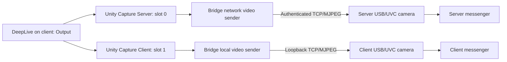

# Two USB/UVC cameras: choose the client or the server

USB to Network Bridge can keep a USB/UVC camera on each Windows PC. A video producer on the client selects which camera receives its output through two independent Unity Capture sources.

| DeepLive output / Unity Capture source | Producer slot | Resulting camera | Where a video application opens it |
| --- | --- | --- | --- |
| **Unity Capture Server** | 0 | Existing server camera, for example `4k web camera` | Server PC |
| **Unity Capture Client** | 1 | Client-local camera, initially `2k web camera` | Client PC |

The source names above identify the two Unity Capture slots. Rename the resulting USB camera in the Bridge camera settings; this does not rename the producer source or change its route. Names such as `2k web camera` and `4k web camera` are labels, independent of the selected resolution. Start with 1280 × 720 at 30 FPS.



DeepLive writes to the selected slot. The two Bridge senders are independent and retain their own source and destination. Selecting one output does not combine the streams or send that stream to both cameras.

## 1. Prepare the two Unity Capture sources on the client

The complete portable ZIP and MSI include the x64 Unity Capture filter. On a clean Windows 11 x64 PC, client first-run setup registers both dedicated sources automatically from local files. Enabling **Client USB camera** also installs a missing registration before creating or changing the camera; an already valid source needs no additional setup. No filter download or compilation is required on that PC.

For an explicit check or repair, stop Live and close applications holding these sources. Open **64-bit Windows PowerShell** in the packaged `app` directory (for example `C:\USBBridge\app`):

```powershell
.\Ensure-VideoPrerequisites.ps1 -Role Client -RuntimeDirectory . -Elevate
```

Approve UAC if registration is needed. The helper verifies the bundled filter, registers **Unity Capture Server** (slot 0) and **Unity Capture Client** (slot 1), and checks their separate identities. A complete existing compatible registration is reused. Conflicting or ambiguous registrations stop with an actionable error rather than taking over another installation or selecting a different source. New registrations use a protected, stable Windows data folder so moving the portable application does not invalidate the filter path. Keep the complete `app` folder for offline repair. OBS and the video-producing application, such as DeepLive or a Unity project, remain separate products.

Verify the sources from the same interactive Windows user/session that runs DeepLive:

```powershell
.\usbbridge.exe --config C:\path\client.local.json client cameras
```

There must be one unambiguous source with each exact name. The local-camera setup resolves **Unity Capture Client** to its enumerated path; it does not substitute another camera if that source is missing or duplicated.

## 2. Enable and name the camera on the client

1. Open **USB to Network Bridge — Client**.
2. Choose **Device → Client USB camera**.
3. Enable **Enable and start with Windows**.
4. Set **Camera name**, initially `2k web camera`, and choose **Video mode**.
5. Keep the default local video TCP port **13251**, or select a free port in 1–65535. Apply the settings.

The client-local receiver and its sender use loopback, so no incoming network-video firewall rule is needed for this camera. Bridge creates a private local connection key automatically; it is separate from the server connection key. Changing the local port or key through the local-camera control updates both local endpoints together.

The receiving PC requires the existing production-signed **USBIP-WIN2** virtual controller. A client already importing USB devices normally has it. The launcher checks driver readiness automatically. For explicit setup, run `Install-ProductionDrivers.ps1 -Role Client` from the package's `app` directory in an elevated PowerShell window, following any request for a manual Windows restart. No Test Signing or modified kernel driver is required; Secure Boot can remain enabled. Use the client configuration path actually used by the launcher for CLI examples; a fresh portable client keeps it under `app\data\Client`.

The camera appears under **Cameras** in Device Manager and in Windows camera applications. Windows uses its inbox `usbvideo.sys`. This is an emulated USB/UVC device: the virtual controller remains visible in the device tree. Its appearance does not establish that physical USB hardware is connected.

Changing the name preserves the camera's serial identity. Applying its name or mode reconnects this local camera; reopen or refresh an application's camera list if it caches the old name.

## 3. Keep the working server camera

The existing server receiver, camera serial/name, network destination and connection key are independent of the new local camera. The local-camera dialog does not replace them.

On the client, **Device → Send video** remains the network sender configuration. Its source for this setup is **Unity Capture Server**. Preserve its working server address and connection key when selecting the source. On the server, **Server → USB camera — receive video** continues to manage the existing camera, for example `4k web camera`.

For network setup and authentication details, see [the video camera guide](virtual-camera.md) and [third-party producer integration](third-party-video.md). The network MJPEG channel authenticates frames but does not encrypt their images; use a trusted LAN or VPN.

## 4. Choose the destination in DeepLive

In the updated DeepLive build on the client, open **Output** and select:

- **Unity Capture Server** to supply the existing camera on the server.
- **Unity Capture Client** to supply the new camera on the client.

Start Live with Unity Capture output enabled. Run DeepLive and the Bridge video senders under the same interactive Windows user/session. In the messenger on the destination PC, select that PC's configured USB camera name.

The two output entries require the corresponding DeepLive integration; registering filters alone does not add routing controls to an unrelated producer. A third-party producer can use the same slots by explicitly selecting the matching Unity Capture device.

## Status, shutdown and recovery

After the first GUI setup, use the normal client configuration path:

```powershell
.\usbbridge.exe --config .\client.local.json client local-camera settings
.\usbbridge.exe --config .\client.local.json client local-camera status
.\usbbridge.exe --config .\client.local.json client local-camera off
.\usbbridge.exe --config .\client.local.json client local-camera on
```

`status` contains separate receiver and local-sender reports. Check that reports are fresh, the receiver is running, its device is attached, its name is applied, and its received-frame count increases. A video application must have the camera open for its supplied-frame rate to measure consumption.

For a scripted settings update:

```powershell
.\usbbridge.exe --config .\client.local.json client local-camera configure 'C:\PrivateBridgeSettings\receive-request.json'
```

The request uses the receiver schema from [the video guide](virtual-camera.md#command-line), with `loopback_only: true`, loopback-only `allowed_ips`, an absolute existing `key_file`, and two distinct nonzero USB/video ports. Preserve the existing `camera.serial` when editing a configured camera. The command synchronizes the local sender's destination and key and preserves the network sender. Keep settings and key files private; never place inline secrets in shell arguments or publish them with logs.

For `client.local.json`, the receiver is stored in `client.video-receive.local.json` and its sender in `client.video-local-send.local.json`. The network sender continues using `client.video-send.local.json`.

Enabled receivers start with Windows; video senders start in the interactive user's session. Independent scheduled checks recover missing or stalled owned video endpoints. Turning the local camera off disables its local receiver/sender recovery without turning off the network sender or physical USB imports.

When no new valid frame reaches a receiver for two seconds, the camera stays registered and supplies black. Some Unity Capture/OBS filters continue producing fresh capture samples containing a frozen previous image, or their own fallback image, after the producer stops. In that case the receiver still sees incoming frames and cannot infer that the content is stale. Verify routing with a changing counter or motion; an increasing frame count alone does not prove fresh producer content.

Generated Bridge USB cameras are excluded as capture sources and rejected by the sender at runtime. Select the Unity Capture producer slot, rather than the camera it feeds, to avoid a feedback loop.

## Кратко по-русски

На клиенте доступны два независимых направления: **Unity Capture Server**, слот 0, передаёт поток в существующую камеру сервера; **Unity Capture Client**, слот 1, — в новую камеру клиента. Имена выходных камер меняются отдельно и не определяют разрешение.

1. Полный ZIP и MSI уже включают x64-фильтр Unity Capture. Первая настройка клиента автоматически регистрирует оба источника из локальных файлов. При необходимости проверки или восстановления выполните `Ensure-VideoPrerequisites.ps1 -Role Client -RuntimeDirectory . -Elevate` из папки `app` в 64-разрядном PowerShell и подтвердите UAC. Отдельно устанавливаются OBS и само приложение-источник, а не фильтр из комплекта.
2. В Bridge-клиенте откройте **Устройство → USB-камера клиента**, включите её и задайте имя, например `2k web camera`, и режим видео. Локальный ключ создаётся автоматически. Настройки работающей серверной камеры сохраняются.
3. В DeepLive, во вкладке **«Вывод»**, выберите **Unity Capture Client** или **Unity Capture Server**. В видеомессенджере на нужном ПК выберите соответствующую USB-камеру.

Приёмник использует подписанный USBIP-WIN2 и штатный драйвер Windows; Test Signing не нужен. Виртуальный контроллер остаётся видимым в диспетчере устройств. Если две секунды нет новых входящих кадров, камера остаётся в системе и показывает чёрный кадр. Если Unity Capture продолжает выдавать замороженную картинку как новые кадры, Bridge не может определить остановку исходного производителя по одному счётчику кадров.

## Optional silent microphone

On either receiver, enable **Silent microphone** in its camera dialog and apply. The client dialog is **Device → Client USB camera**; the server dialog is **Server → USB camera — receive video**. The setting is saved as `camera.microphone: true`; missing/false preserves the original video-only device. Changing this setting briefly reconnects that generated camera while preserving its serial. Reopen applications using the camera or refresh their camera and microphone lists after applying. Renaming the camera, changing its video mode or turning reception off/on retains the saved microphone choice. While reception is off, its dependent controls are disabled without resetting their values.

Windows enumerates an additional USB Audio Class capture function under the same composite USB parent as the camera. It supplies mono 48 kHz / 16-bit PCM silence locally, including when network video is absent. It never opens a physical microphone, forwards audio, or adds a network port. Windows uses its inbox audio class driver with the existing signed USB/IP controller.

The **receiving PC** also needs **Windows Audio Endpoint Builder** (`AudioEndpointBuilder`) and **Windows Audio** (`Audiosrv`) running. Applying an enabled receiver with **Silent microphone** starts these services if they are stopped. It respects an explicitly Disabled service: setup reports how to enable it, before changing a working camera endpoint. Without these services, the USB audio function can appear in Device Manager without a usable microphone appearing in applications. Check their state in PowerShell:

```powershell
Get-Service -Name AudioEndpointBuilder,Audiosrv | Select-Object Name,Status,StartType
```

If audio was disabled on that PC, open `services.msc` as Administrator, set these two services to **Automatic**, and start Endpoint Builder before Windows Audio. Allow microphone access for the target desktop application in Windows privacy settings, then refresh its audio devices. Endpoint Builder creates and activates Windows audio endpoints; see [Microsoft's audio endpoint documentation](https://learn.microsoft.com/en-us/windows-hardware/drivers/audio/audio-endpoint-builder-algorithm).

Messengers normally have separate camera and microphone selectors. Select the associated microphone in the app audio settings if it does not select it automatically. A shared device container allows applications to associate the two functions, but does not force an app to change its selected audio input. This feature does not make a camera-only application expose an audio selector.

По-русски: включите **«Микрофон (тишина)»** в настройках нужной камеры и примените. Камера кратко переподключится; после этого обновите список устройств или заново откройте её в приложении. Микрофон появится как аудиовход того же составного USB-устройства и будет выдавать тишину. Настоящий микрофон не захватывается. В мессенджере при необходимости выберите этот вход отдельно от камеры. На принимающем ПК должны работать службы **AudioEndpointBuilder** и **Audiosrv**; при включении микрофона Bridge запускает остановленные службы, но не меняет явно отключённый тип запуска. Если они отключены, включите автоматический запуск в `services.msc` от администратора и запустите обе службы. Проверьте разрешение на доступ к микрофону в параметрах конфиденциальности Windows.
